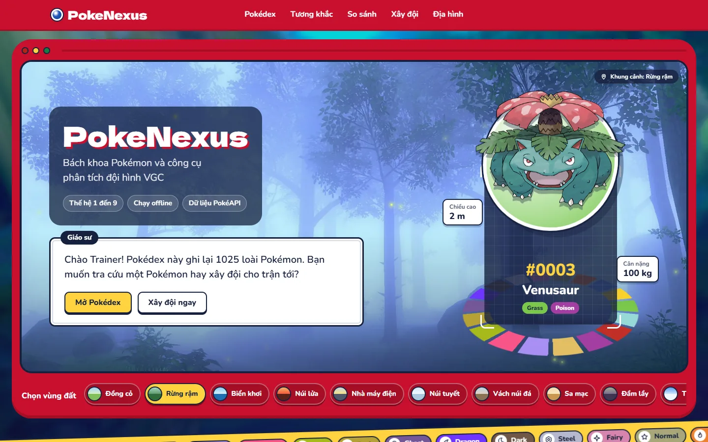
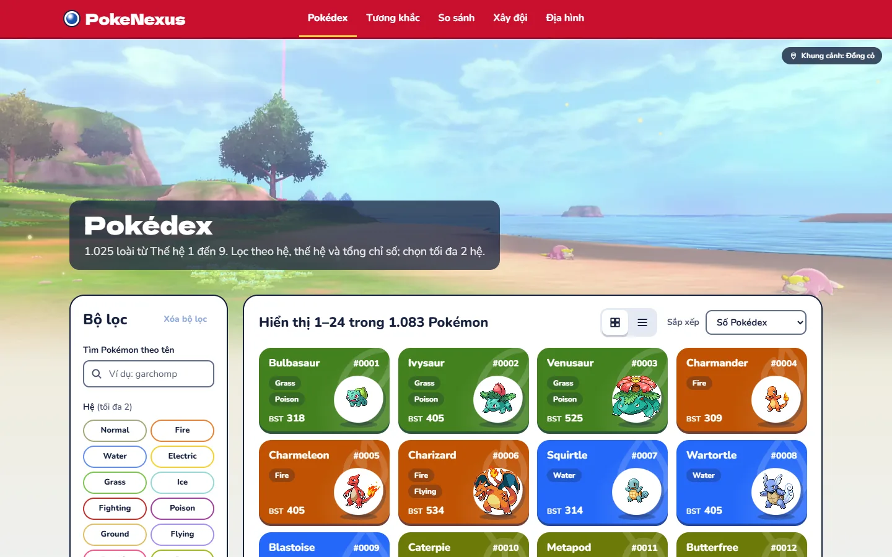
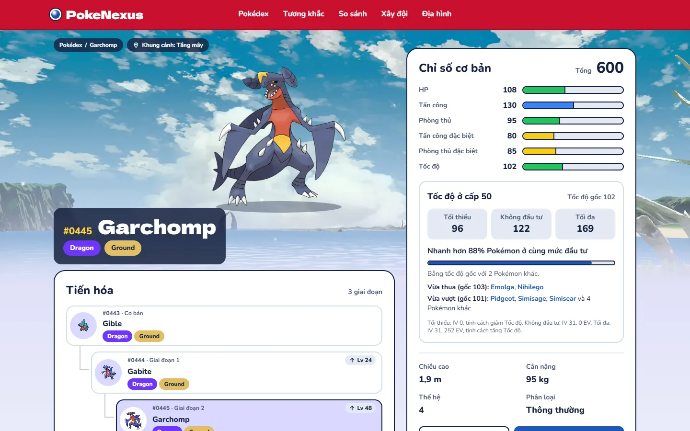
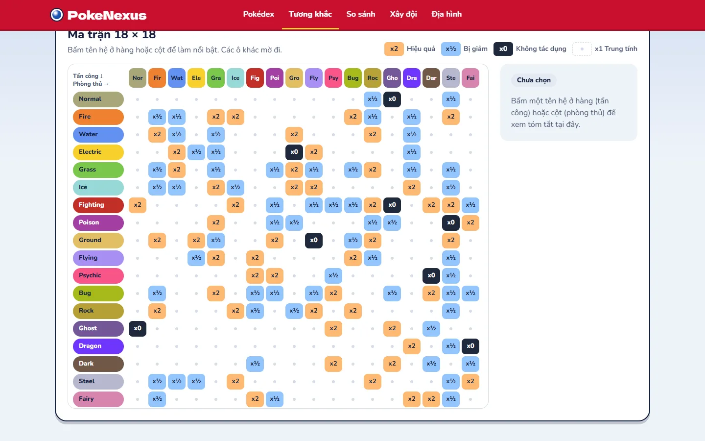
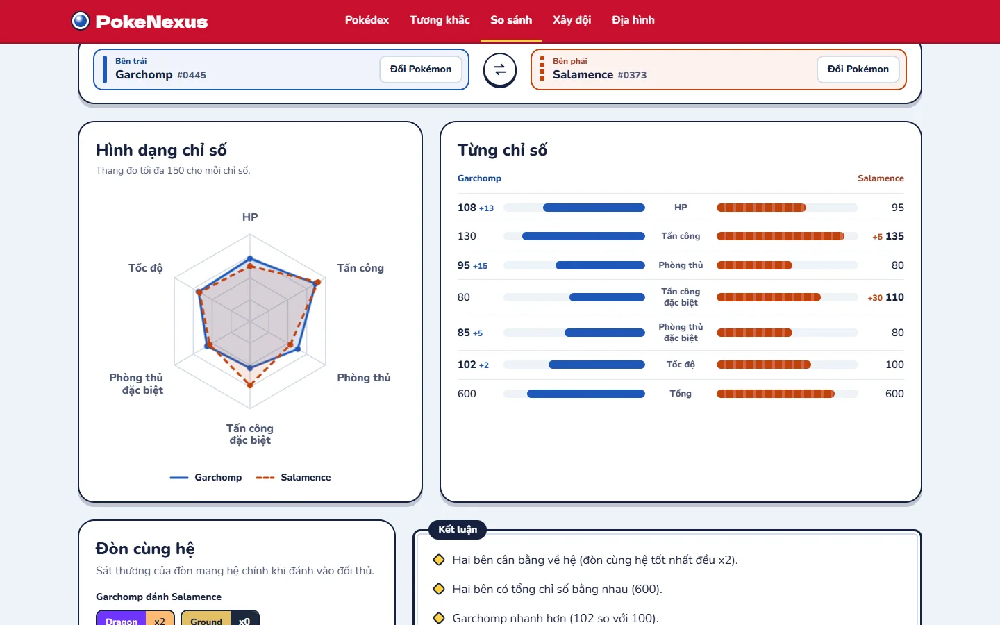
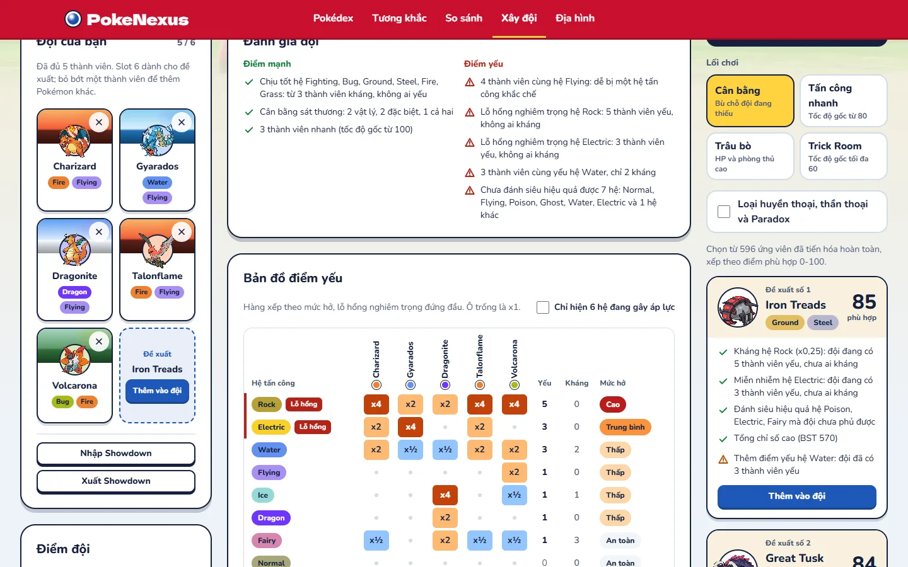
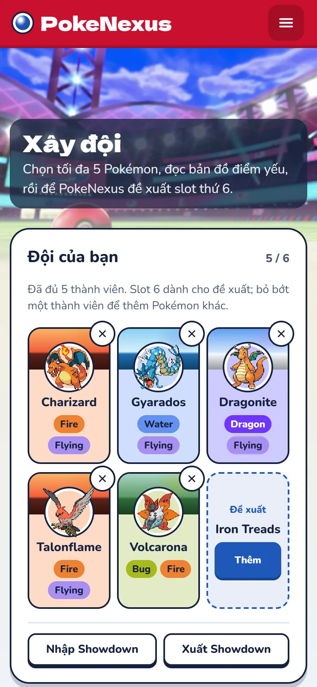

# PokeNexus

**Ultimate Encyclopedia & VGC Meta Hub** - bách khoa toàn thư Pokémon kiêm công cụ xây dựng và phân tích đội hình cho thể thức đấu đôi VGC.

https://github.com/Nha-Cong-Dong/PokeNexus

| Mục | Link |
|---|---|
| Dùng thử | https://pokenexus.pages.dev (frontend Cloudflare Pages; backend Render Free có thể mất 1-3 phút để thức dậy nếu lâu không có ai dùng) |
| API | https://pokenexus-api-s6g6.onrender.com/api/v1/health |
| Báo cáo tổng kết | [docs/pitching/PokeNexus-BaoCao.docx](docs/pitching/PokeNexus-BaoCao.docx) |
| Slide pitching | [docs/pitching/slides.html](docs/pitching/slides.html) (mở bằng trình duyệt, chạy không cần mạng), [PokeNexus-Pitch.pptx](docs/pitching/PokeNexus-Pitch.pptx) |
| Kiểm tra bản đã deploy | `node scripts/acceptance-check.mjs` ([docs/deploy.md](docs/deploy.md), Phần 8) |

---

## Phần 1. Giới thiệu

### I. Vấn đề

- Dữ liệu Pokémon nằm rải rác: một trang tra chỉ số, một trang xem tương khắc hệ, một công cụ khác để kiểm tra đội hình.
- Bảng tương khắc 18 x 18 hệ khó nhớ, người chơi mới không biết vì sao đội hình của mình thua.
- Người chơi VGC mất nhiều thời gian kiểm tra thủ công điểm yếu chung của cả đội.

### II. Giải pháp

- Một nơi duy nhất để tra cứu, so sánh, xây đội và phân tích.
- **Synergy Analyzer** chỉ ra lỗ hổng phòng thủ của đội và đề xuất Pokémon lấp lỗ hổng, kèm lý do cụ thể.

### III. Người dùng mục tiêu

| Nhóm                | Nhu cầu chính                                  |
| ------------------- | ---------------------------------------------- |
| Người chơi mới      | Tra cứu nhanh, hiểu hệ nào khắc hệ nào         |
| Người chơi VGC      | Kiểm tra lỗ hổng đội hình, tìm Pokémon bổ sung |
| Người thích số liệu | So sánh chỉ số, xem thống kê                   |

---

## Phần 2. Tính năng

### I. Phạm vi MVP

| Tính năng                        | Mô tả                                                                                 |
| -------------------------------- | ------------------------------------------------------------------------------------- |
| Omni-Dex                         | Tra cứu Pokémon, lọc theo Hệ, Thế hệ, Chỉ số; phân trang; trạng thái lọc lưu trên URL |
| Chi tiết Pokémon                 | Chỉ số gốc, hệ, bảng phòng thủ 18 hệ, các dạng (form)                                 |
| Bảng tương khắc                  | Ma trận 18 x 18 tương tác, hỗ trợ tra hệ kép                                          |
| Bàn Cân Sức Mạnh                 | So sánh 2 Pokémon bằng biểu đồ Radar và kết luận tự động                              |
| Team Builder và Synergy Analyzer | Chọn tối đa 5 Pokémon, xem ma trận điểm yếu, nhận 3 đề xuất cho vị trí thứ 6          |
| Lưu và chia sẻ đội hình          | Lưu đội không cần đăng nhập, chia sẻ bằng đường dẫn                                   |
| Trang Tổng quan                  | Giới thiệu, lối vào 4 công cụ, vòng tương khắc, Pokémon hôm nay, câu đố hệ số         |

- Tiến độ từng tính năng: Phần 7.

### II. Mở rộng (sau MVP)

- Cây tiến hóa tương tác.
- Bảng tốc độ (Speed Tier) ở cấp 50, có tùy chọn Tailwind, Trick Room.
- Nhập và xuất đội hình theo định dạng văn bản của Pokémon Showdown.
- Tính chỉ số thực theo EV, IV, Nature.

### III. Hướng phát triển

- Đăng nhập, danh sách yêu thích, thư viện đội công khai.
- Chiêu thức và độ phủ tấn công theo chiêu thực tế, tính sát thương.
- World Explorer: vùng đất, Gym Leader.

### IV. Ảnh chụp

| Trang | Ảnh |
|---|---|
| Tổng quan `/` |  |
| Omni-Dex `/pokedex` |  |
| Chi tiết `/pokemon/garchomp` |  |
| Bảng tương khắc `/types` |  |
| So sánh `/compare?left=garchomp&right=salamence` |  |
| Xây đội, đội demo `/team-builder?ids=6,130,149,663,637` |  |
| Xây đội trên điện thoại (390 px) |  |

- Chụp ngày 2026-11-05 từ bản `main` (commit `c621d36`) chạy local, Chrome 1440 x 900; ảnh điện thoại 390 x 844 ở tỉ lệ điểm ảnh 2.

---

## Phần 3. Công nghệ

| Tầng     | Công nghệ                                                                                                               |
| -------- | ----------------------------------------------------------------------------------------------------------------------- |
| Frontend | React, TypeScript, Vite, Tailwind CSS, TanStack Query, React Router; biểu đồ vẽ bằng SVG (không dùng Recharts)          |
| Backend  | Java 25 (LTS), Spring Boot 4.1, Spring Web MVC, Spring Data JPA (Hibernate), Bean Validation, Flyway, springdoc-openapi |
| Database | MySQL 8.4 (LTS)                                                                                                         |
| Dữ liệu  | PokéAPI (nạp một lần từ bộ CSV công khai, không gọi API lúc chạy)                                                       |
| Hạ tầng  | Docker Compose, GitHub Actions                                                                                          |

- Lý do lựa chọn các công nghệ chính được ghi trong [docs/adr](docs/adr).

---

## Phần 4. Kiến trúc tổng quan

```text
Trình duyệt (React + TypeScript)
        |  REST / JSON
        v
Spring Boot API  (Controller -> Service -> Repository)
        |                 |
        |                 +-- Cache trong bộ nhớ: bảng tương khắc, hồ sơ phòng thủ Pokémon
        v
     MySQL 8.4  <-- Flyway migration + dữ liệu nạp từ CSV của PokéAPI
```

- Chi tiết: [docs/architecture.md](docs/architecture.md), [docs/database.md](docs/database.md), [docs/api.md](docs/api.md).

---

## Phần 5. Cài đặt và chạy

### I. Yêu cầu

| Công cụ                  | Phiên bản                  |
| ------------------------ | -------------------------- |
| JDK                      | 25                         |
| Node.js                  | 24 LTS (xem file `.nvmrc`) |
| Docker và Docker Compose | Bản ổn định mới nhất       |
| Git                      | 2.40 trở lên               |

### II. Chạy nhanh

```bash
git clone https://github.com/Nha-Cong-Dong/PokeNexus.git && cd PokeNexus
cp .env.example .env
docker compose up -d mysql
bash scripts/download-csv.sh
cd backend && ./mvnw spring-boot:run
cd frontend && npm ci && npm run dev
```

- Hai lệnh cuối chạy ở hai cửa sổ terminal riêng, tính từ thư mục gốc. Trong PowerShell: `Copy-Item .env.example .env`, `powershell -ExecutionPolicy Bypass -File scripts/download-csv.ps1`, `.\mvnw.cmd spring-boot:run`.
- Lần khởi động đầu, backend tự nạp CSV vào MySQL (khoảng 3 giây với bộ đầy đủ). `GET http://localhost:8080/api/v1/health` trả `"dataLoaded": true` khi đã nạp xong.
- Mở `http://localhost:5173`. Swagger UI ở `http://localhost:8080/swagger-ui.html`.

### III. Ghi chú

- Sửa `DB_PASSWORD` và `DB_ROOT_PASSWORD` trong `.env` trước khi chạy. File `.env` không được commit. Cổng 3306 trên máy đã bị chiếm thì đổi `DB_PORT` (Docker Compose và backend cùng đọc biến này).
- Nguồn CSV, commit PokéAPI cố định và số liệu: [data/README.md](data/README.md). Lệnh chi tiết của từng phần: [backend/README.md](backend/README.md), [frontend/README.md](frontend/README.md), Phần 2.
- Công cụ quản trị DB trên trình duyệt (Adminer): `docker compose --profile tools up -d`, sau đó mở `http://localhost:8081`.
- Chạy backend bằng Docker, không cần cài JDK: `docker compose --profile app up -d --build` dựng image từ `backend/Dockerfile` và chạy cùng MySQL ở `http://localhost:8080`. Container đọc CSV trong `data/csv/` và tự nạp khi DB còn trống. Dừng bằng `docker compose --profile app down`.

---

## Phần 6. Cấu trúc thư mục

```text
pokenexus/
├── backend/                Spring Boot API
├── frontend/               React + TypeScript (Vite)
├── data/                   Dữ liệu nguồn (CSV PokéAPI, không commit file CSV)
├── docs/                   Tài liệu sản phẩm, đặc tả, kiến trúc, ADR
├── scripts/                Script tải dữ liệu, sprite, sao lưu DB
├── .github/                Issue template, PR template, CI, Dependabot
├── docker-compose.yml      MySQL và công cụ phát triển
├── .env.example            Mẫu biến môi trường
├── CONTRIBUTING.md         Quy trình làm việc, quy ước commit và nhánh
├── CHANGELOG.md            Lịch sử thay đổi
├── PLAN.md                 Tiến độ tuần hiện tại
└── CLAUDE.md               Hướng dẫn cho Claude Code (kèm .claude/)
```

- Chi tiết đến cấp package và file: [docs/folder-structure.md](docs/folder-structure.md).

---

## Phần 7. Lộ trình

| Mốc                         | Nội dung                                                         |
| --------------------------- | ---------------------------------------------------------------- |
| Tuần 1 (18/10 - 25/10)      | Nghiên cứu, ý tưởng, tài liệu, khung dự án (Checkpoint 2)        |
| Tuần 2 (26/10 - 01/11)      | MVP chạy end-to-end ở local (Checkpoint 3); triển khai production 30-31/10 |
| Tuần 3 (02/11 - 08/11)      | Kiểm thử, sửa lỗi, tài liệu; bản hoàn chỉnh trên link thật, demo, tag `v1.0.0` (Checkpoint 4) |

- Kế hoạch chi tiết: [docs/roadmap.md](docs/roadmap.md). Trạng thái hiện tại chỉ ghi ở [PLAN.md](PLAN.md).

---

## Phần 8. Tài liệu

- Mục lục toàn bộ tài liệu (sản phẩm, đặc tả, kiến trúc, database, API, giao diện, quy trình, ADR) và bảng "muốn làm gì thì xem ở đâu": [docs/README.md](docs/README.md).

---

## Phần 9. Thông tin khác

### I. Đóng góp

- Quy trình làm việc, quy ước nhánh và commit: [CONTRIBUTING.md](CONTRIBUTING.md).

### II. Giấy phép

- Mã nguồn và tài liệu phát hành theo giấy phép [MIT](LICENSE).

### III. Miễn trừ và nguồn dữ liệu

- Pokémon cùng tên gọi, nhân vật, hình ảnh liên quan là thương hiệu của Nintendo, Game Freak và The Pokémon Company.
- PokeNexus là dự án phi thương mại của người hâm mộ, không liên kết hay được bảo trợ bởi các công ty trên.
- Dữ liệu và hình ảnh lấy từ [PokéAPI](https://pokeapi.co), tuân theo giấy phép của PokéAPI.

### IV. Tác giả

- Nguyễn Quốc Khánh - Full-stack
  - GitHub: https://github.com/NgQKhanh2906
  - Email: nguyenqkhanhlc2006@gmail.com
