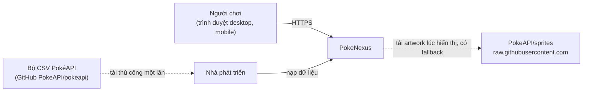
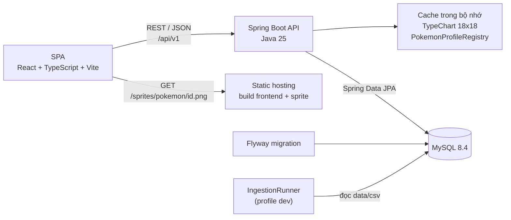
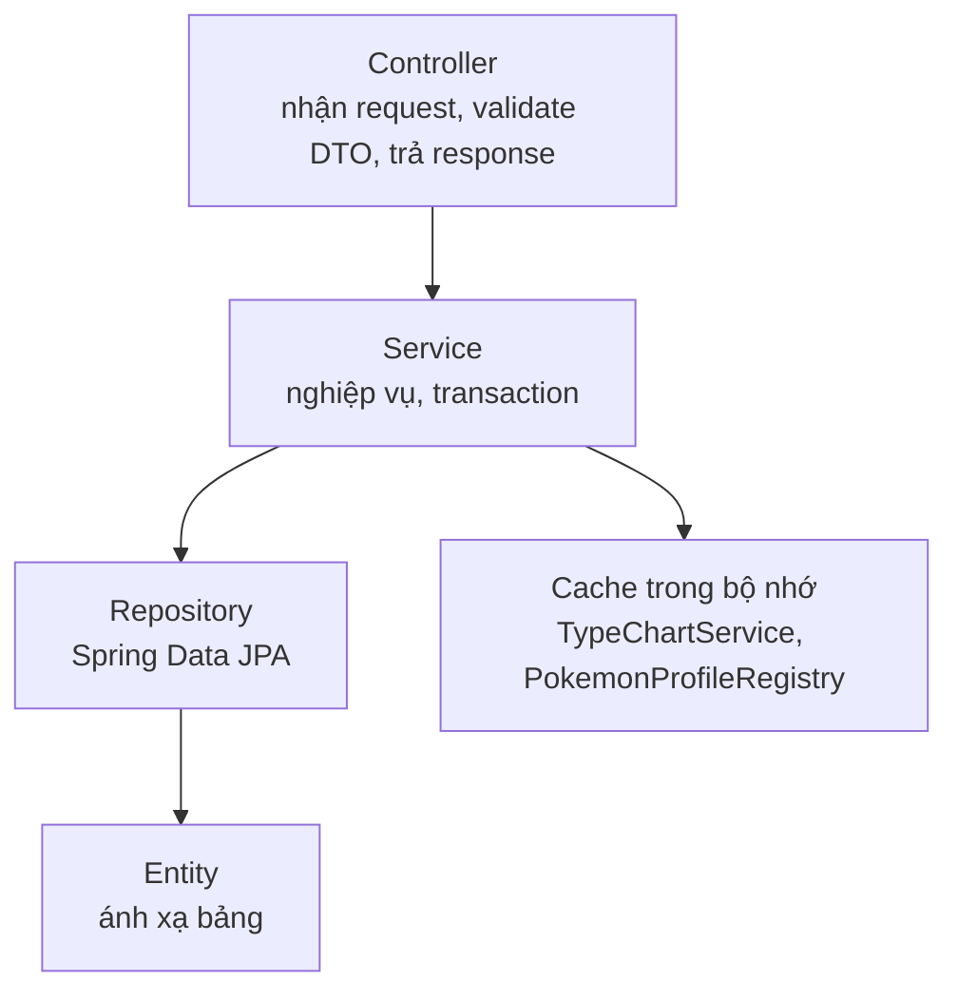
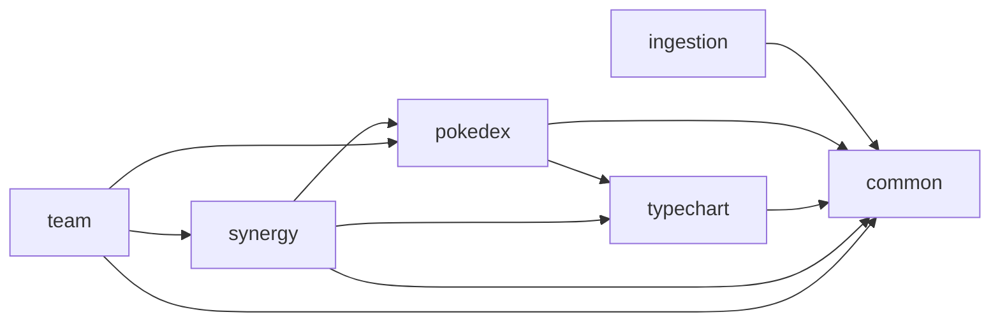
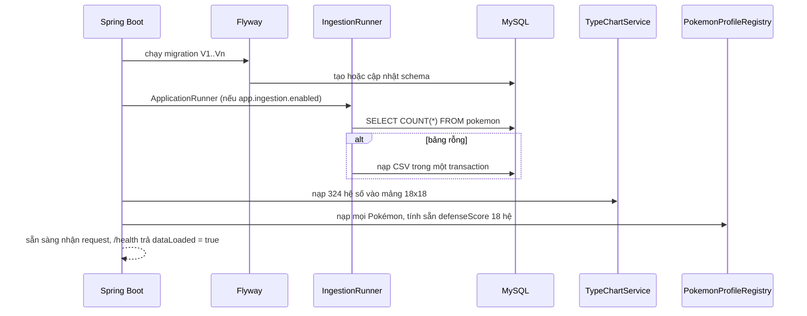
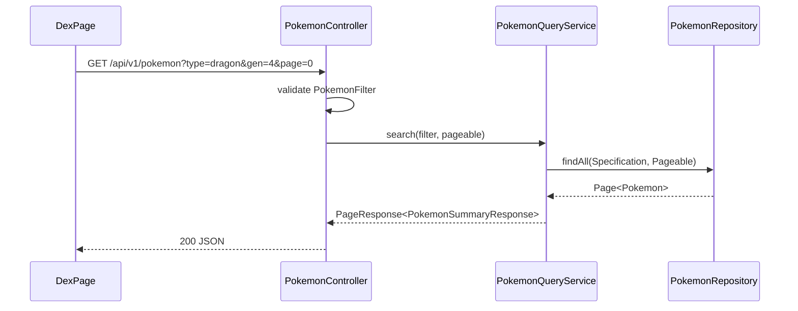
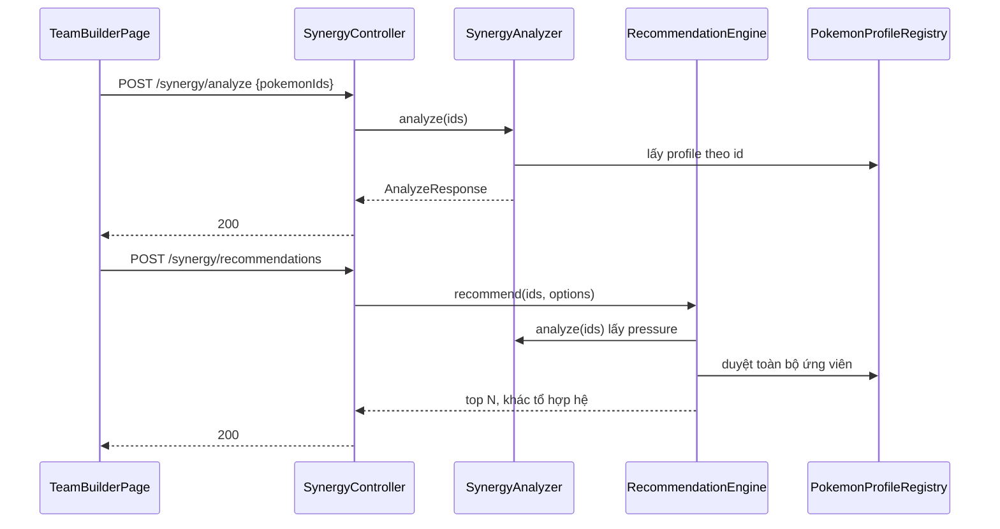
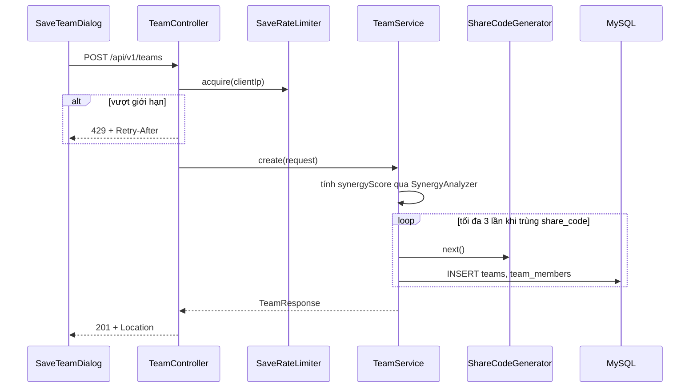
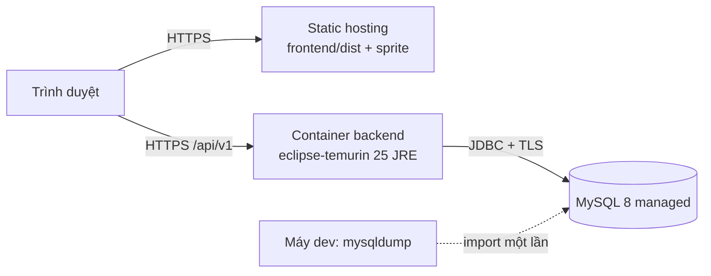

# PokeNexus - Kiến trúc hệ thống

- Phiên bản: 0.5 (cập nhật 2026-10-28; Phần 6: route `/terrain/:terrainId?`, tiến độ Trainer trong `localStorage`; Phần 5: độ phủ tấn công tính sẵn khi nạp, `excludeLegendary` loại cả Pokémon Paradox; Phần 8: giới hạn số client theo dõi khi lưu đội; Phần 9-11: script đo p95, `backend/Dockerfile`, service `backend` trong Docker Compose)
- Các quyết định quan trọng được ghi chi tiết trong [adr/](adr).
- Cây thư mục và tên class cụ thể: [folder-structure.md](folder-structure.md). Đặc tả endpoint: [api.md](api.md). Schema: [database.md](database.md).

---

## Phần 1. Tổng quan

### I. Sơ đồ ngữ cảnh (C4 cấp 1)



- Lúc chạy, PokeNexus không gọi REST API của PokéAPI. Phụ thuộc bên ngoài duy nhất là ảnh artwork, và đã có fallback về sprite tự host ([ADR 0005](adr/0005-hybrid-image-assets.md)).

### II. Sơ đồ container (C4 cấp 2)



### III. Nguyên tắc kiến trúc

- **Dữ liệu offline:** dữ liệu Pokémon được nạp một lần từ CSV vào MySQL; ứng dụng không gọi PokéAPI lúc chạy ([ADR 0002](adr/0002-offline-data-from-csv.md)).
- **Tính toán trong bộ nhớ:** dữ liệu tĩnh nhỏ (khoảng 1.300 Pokémon x 18 hệ) được nạp vào RAM khi khởi động để thuật toán chạy nhanh ([ADR 0003](adr/0003-in-memory-synergy.md)).
- **Monorepo:** backend, frontend, tài liệu nằm chung một repo ([ADR 0001](adr/0001-monorepo.md)).
- **Backend chỉ trả dữ liệu:** URL ảnh do frontend sinh từ ID Pokémon, backend không biết frontend được host ở đâu ([ADR 0005](adr/0005-hybrid-image-assets.md)).
- **Không trạng thái phiên:** API không dùng session; mọi request độc lập, dễ chạy nhiều instance về sau.

---

## Phần 2. Công nghệ

### I. Bảng phiên bản

| Thành phần | Lựa chọn | Ghi chú |
|---|---|---|
| Ngôn ngữ backend | Java 25 (LTS) | [ADR 0004](adr/0004-java-25-spring-boot-4.md) |
| Framework | Spring Boot 4.1.x | Spring Framework 7, Jakarta EE 11 |
| Build | Maven Wrapper (`mvnw`) | Không cần cài Maven trên máy |
| Truy cập dữ liệu | Spring Data JPA (Hibernate) | Dùng Specification cho bộ lọc động |
| Migration | Flyway | Script trong `backend/src/main/resources/db/migration` |
| Đọc CSV | Apache Commons CSV | Xử lý đúng trường có dấu ngoặc kép, dấu phẩy |
| Tài liệu API | springdoc-openapi | Swagger UI tại `/swagger-ui.html` |
| Kiểm thử backend | JUnit 5, AssertJ, Mockito, Testcontainers (MySQL) | |
| Database | MySQL 8.4 (LTS) | `utf8mb4`, chạy bằng Docker |
| Frontend | React + TypeScript + Vite | Node.js 24 LTS |
| Giao diện | Tailwind CSS 4.x | Token định nghĩa bằng `@theme` trong CSS ([design-system.md](design-system.md)) |
| Định tuyến | React Router | Đồng bộ bộ lọc lên URL |
| Gọi API | TanStack Query 5.x | Cache, trạng thái tải và lỗi |
| Biểu đồ | SVG tự vẽ (`StatRadar`, cột thế hệ ở trang Tổng quan); Recharts 3.x để dự phòng | Quyết định 2026-10-26: MVP chỉ cần radar 6 trục và biểu đồ cột đơn giản, vẽ bằng SVG không thêm dependency và không cần cài gói khi máy không có người duyệt; chỉ cài Recharts khi cần tooltip, trục, chú giải phức tạp |
| Font | Dela Gothic One, Nunito, Pixelify Sans qua `@fontsource` và `@fontsource-variable` | Đóng gói cùng build, chạy offline ([assets.md](assets.md), [design-system.md](design-system.md), Phần 2, mục V) |
| Kiểm thử frontend | Vitest, React Testing Library | |
| CI | GitHub Actions | Xem `.github/workflows/ci.yml` |

- Major version của các thư viện frontend được đối chiếu với npm registry ngày 2026-10-19. Bản vá cụ thể chốt khi khởi tạo mã nguồn ở Tuần 2.
- Thêm dependency ngoài bảng này phải có lý do ghi trong PR.

---

## Phần 3. Kiến trúc backend

### I. Phân tầng



- Luồng một chiều Controller -> Service -> Repository. Controller không gọi Repository.
- DTO dùng Java `record`; Entity không ra khỏi tầng Service.
- Transaction đặt ở Service: `@Transactional(readOnly = true)` cho truy vấn, `@Transactional` cho ghi.

### II. Package theo tính năng và quy tắc phụ thuộc



- Mũi tên A -> B nghĩa là A được phép dùng **Service hoặc DTO công khai** của B. Không dùng Repository hay Entity của package khác.
- `common` không phụ thuộc package tính năng nào.
- `ingestion` chỉ ghi DB qua Repository của chính nó (dùng JDBC batch), không phụ thuộc package tính năng.
- Danh sách class từng package: [folder-structure.md](folder-structure.md), Phần 2.

---

## Phần 4. Luồng xử lý chính

### I. Khởi động ứng dụng



- Cache được nạp sau ingestion: hai bean cache lắng nghe `ApplicationReadyEvent`, còn `IngestionRunner` chạy trước ở `ApplicationRunner` có `@Order` nhỏ hơn.
- DB rỗng và ingestion bị tắt: ứng dụng vẫn chạy, `/health` trả `dataLoaded = false`, các API dữ liệu trả 503.

### II. Omni-Dex



### III. Phân tích và đề xuất đội



- Hai luồng này không truy vấn DB. Frontend gọi lại `analyze` mỗi khi đội thay đổi (debounce 300 ms) và chỉ gọi `recommendations` khi người dùng mở khu vực đề xuất.

### IV. Lưu và chia sẻ đội



---

## Phần 5. Thuật toán Synergy Analyzer

### I. Thang điểm phòng thủ

| Hệ số chịu đòn | 0 (miễn nhiễm) | 0.25 | 0.5 | 1 | 2 | 4 |
|---|---|---|---|---|---|---|
| `defenseScore` | +3 | +2 | +1 | 0 | -1 | -2 |

- Hệ số hệ kép bằng tích hai hệ số đơn (ví dụ Fire/Flying chịu Rock: 2 x 2 = 4).
- `defenseScore` của mọi Pokémon với 18 hệ được tính sẵn khi khởi động.
- Các hệ phòng thủ mà mỗi Pokémon đánh siêu hiệu quả bằng hệ của nó (`superEffectiveAgainst`) cũng được tính sẵn khi nạp `PokemonProfileRegistry`; phân tích và đề xuất không tra bảng hệ số khi xử lý request.
- Chỉ tính theo hệ; Ability (ví dụ Levitate) và vật phẩm nằm ngoài phạm vi MVP.

### II. Phân tích đội

```text
FOR mỗi hệ tấn công a:
    weakness[a]   = tổng (-defenseScore) của các thành viên có điểm âm
    resistance[a] = số thành viên có defenseScore > 0
    pressure[a]   = max(0, weakness[a] - resistance[a])
    criticalHole[a] = weakness[a] >= 2 AND resistance[a] == 0

teamScore = clamp(100 - 4 * SUM(pressure) - 8 * COUNT(criticalHole), 0, 100)

offensiveCoverage = số hệ phòng thủ d (trong 18 hệ) mà tồn tại thành viên có hệ t với factor(t, d) = 2
statRadar        = trung bình từng chỉ số gốc của các thành viên
```

- Độ phức tạp `O(18 x n)` với `n <= 6`. Đội đủ 6 (5 thành viên chọn và 1 đề xuất ở slot 6) vẫn được chấm điểm, để thấy điểm đội tăng khi thêm đề xuất.

### III. Đề xuất vị trí tiếp theo

#### 1. Tập ứng viên

- Đội đầu vào có 1-5 thành viên (`RecommendationEngine.MAX_TEAM_SIZE`); đội đủ 6 không còn vị trí để đề xuất.
- `form_category` là `DEFAULT` hoặc `REGIONAL`; loài đã tiến hóa hoàn toàn; không có trong đội.
- `excludeLegendary = true` thì loại huyền thoại, thần thoại và 20 Pokémon Paradox (`RecommendationEngine.PARADOX_POKEMON_IDS`: 984-995, 1005, 1006, 1009, 1010, 1020-1023; CSV PokéAPI không đánh dấu Paradox là huyền thoại); `minBaseStatTotal` lọc theo BST.

#### 2. Chấm điểm

| Thành phần | Trọng số | Cách tính |
|---|---|---|
| Phòng thủ | 60% | Cộng `pressure[a] x s` khi ứng viên kháng hệ `a`; trừ `(1 + pressure[a]) x (-s)` khi ứng viên yếu hệ `a` (`s` là `defenseScore` của ứng viên với hệ `a`) |
| Độ phủ tấn công | 25% | Số hệ đội chưa đánh siêu hiệu quả mà ứng viên đánh được bằng hệ của nó |
| Chỉ số | 15% | Tổng chỉ số gốc của ứng viên |

- Mỗi thành phần được chuẩn hóa min-max về 0-1 trên tập ứng viên (mọi ứng viên bằng nhau thì thành phần đó bằng 0), cộng trọng số rồi nhân 100 để ra `score`.
- Sắp xếp giảm dần theo `score` đã làm tròn 1 chữ số; hòa điểm thì BST cao hơn đứng trước, tiếp theo là ID nhỏ hơn (để kết quả ổn định khi test).
- Chỉ giữ ứng viên điểm cao nhất của mỗi tổ hợp hệ (không phân biệt thứ tự hệ), lấy `limit` phần tử đầu.
- Độ phức tạp `O(N x 18 + N log N)` với `N` khoảng 1.300.
- Trọng số là hằng số trong code (quyết định ở [spec.md](spec.md), Phần 5); được tinh chỉnh bằng các đội thử nghiệm ở spec, mục V.4.

#### 3. Sinh lý do

| Điều kiện | Mẫu câu |
|---|---|
| Ứng viên kháng hoặc miễn nhiễm hệ `a` có `pressure[a] > 0` (lấy tối đa 2 hệ có pressure cao nhất) | "Chống chịu hệ Rock (đội đang hở mức 8)" |
| Ứng viên đánh siêu hiệu quả hệ đội chưa phủ | "Bổ sung độ phủ tấn công lên hệ Water, Fairy" |
| BST thuộc nhóm 25% cao nhất tập ứng viên | "Tổng chỉ số cao (BST 600)" |
| Không điều kiện nào khớp | Dùng câu về BST, bảo đảm luôn có ít nhất 1 lý do |

---

## Phần 6. Kiến trúc frontend

### I. Định tuyến

| Route | Trang | Trạng thái trên URL |
|---|---|---|
| `/` | `LandingPage` | |
| `/pokedex` | `DexPage` | `type`, `gen`, `minBst`, `maxBst`, `minSpeed`, `form`, `sort`, `page` |
| `/pokemon/:idOrName` | `PokemonDetailPage` | |
| `/types` | `TypeChartPage` | `def` (1-2 hệ phòng thủ đang chọn) |
| `/compare` | `ComparePage` | `left`, `right` |
| `/team-builder` | `TeamBuilderPage` | `ids` (đội nháp, ví dụ `ids=6,130,149`); `add` (thêm một Pokémon vào đội nháp đang có rồi tự xóa khỏi URL, dùng cho nút "Thêm vào đội"); `six` (thành viên slot 6: đề xuất đã chọn hoặc thành viên thứ 6 của đội chia sẻ; chỉ có hiệu lực khi đội nháp đủ 5, reload vẫn giữ) |
| `/team/:shareCode` | `SharedTeamPage` | |
| `/terrain/:terrainId?` | `TerrainPage` | `terrainId` trên đường dẫn (13 địa hình; ID lạ chuyển về `/terrain`) |
| `*` | `NotFoundPage` | |

### II. Dữ liệu và trạng thái

| Loại trạng thái | Nơi lưu | Ví dụ |
|---|---|---|
| Dữ liệu từ server | TanStack Query | Danh sách Pokémon, ma trận hệ, kết quả phân tích |
| Trạng thái chia sẻ được | Query string trên URL | Bộ lọc Omni-Dex, cặp so sánh |
| Đội nháp | Hook `useTeamDraft` (`useReducer`), đồng bộ URL và `localStorage` | 5 slot Team Builder |
| Tiến độ Trainer | Hook `useTrainerProgress`, `localStorage` khóa `pokenexus.trainer`; mỗi trang giữ một bản và truyền xuống component con | Điểm, chuỗi đúng dài nhất, Ball, huy hiệu của Thử tài Trainer và Who's that Pokémon? |
| Trạng thái giao diện cục bộ | `useState` trong component | Mở hoặc đóng dialog; ô loại huyền thoại ở Team Builder (không lên URL vì `useTeamDraft` quản lý query string của trang) |

| Query key | `staleTime` | Lý do |
|---|---|---|
| `['types']`, `['types', 'matrix']` | `Infinity` | Dữ liệu tĩnh |
| `['pokemon', id]` | `Infinity` | Dữ liệu tĩnh |
| `['pokemon', 'list', filter]` | 5 phút | Tránh gọi lại khi quay lại trang |
| `['synergy', 'analyze', ids]` | `Infinity` | Kết quả xác định theo đầu vào |
| `['compare', left, right]` | `Infinity` | Kết quả xác định theo cặp; không thử lại khi lỗi 4xx |
| `['pokemon', 'search', q]` | 5 phút | Gợi ý tên khi gõ |
| `['pokemon', 'generation-count', n]` | `Infinity` | Số loài mỗi thế hệ ở trang Tổng quan |
| `['pokemon', 'type-pool', type]` | `Infinity` | 100 Pokémon đầu theo ID của một hệ cho trang Địa hình |

- Không thêm thư viện quản lý state toàn cục trong MVP; đội nháp là trạng thái toàn cục duy nhất. Tiến độ Trainer không phải state toàn cục: mỗi trang đọc `localStorage` khi mở và ghi lại khi thay đổi.
- Mỗi route bọc `ErrorBoundary`; lỗi API hiển thị `ErrorState` có nút thử lại ([design-system.md](design-system.md), Phần 5).

---

## Phần 7. Xử lý lỗi, validation, logging

### I. Validation

- Validate DTO bằng Bean Validation (`@NotEmpty`, `@Size`, `@Min`, `@Max`, `@Pattern`); ràng buộc nghiệp vụ (ID trùng, ID không tồn tại) kiểm tra ở Service.
- Frontend validate cùng quy tắc để báo lỗi sớm, nhưng backend luôn là nơi kiểm tra cuối cùng.

### II. Xử lý lỗi

- Một `GlobalExceptionHandler` (`@RestControllerAdvice`) chuyển mọi exception sang `ProblemDetail` (RFC 9457), có thêm thuộc tính `code`.
- Danh mục `code` và mã HTTP tương ứng: [api.md](api.md), Phần 4.
- Lỗi 500 không trả stack trace hay thông điệp nội bộ ra client; chỉ ghi log.

### III. Logging

- SLF4J với Logback mặc định của Spring Boot. Mức `INFO` cho `com.pokenexus`, `WARN` cho thư viện.
- Ghi log: tóm tắt ingestion (số dòng từng bảng, thời gian), thời gian nạp cache, lỗi 4xx ở mức `DEBUG`, lỗi 5xx ở mức `ERROR` kèm stack trace.
- Không ghi địa chỉ IP vào log lâu dài; bộ giới hạn tần suất chỉ giữ IP trong bộ nhớ.

---

## Phần 8. Bảo mật

### I. Biện pháp

| Rủi ro | Biện pháp |
|---|---|
| Gọi API từ origin lạ | CORS chỉ cho phép `CORS_ALLOWED_ORIGINS` |
| Spam lưu đội | `SaveRateLimiter`: 10 lần lưu mỗi phút mỗi IP (cửa sổ cố định, trong bộ nhớ); vượt thì 429. Theo dõi tối đa 10.000 IP (`MAX_TRACKED_CLIENTS`): khi đầy, IP mới chỉ được nhận sau khi dọn cửa sổ hết hạn, nếu vẫn đầy thì nhận 429 |
| Đoán mã chia sẻ | `share_code` 8 ký tự base62 từ `SecureRandom` (62^8, khoảng 2,18 x 10^14 tổ hợp); `id` nội bộ không lộ ra API |
| SQL injection | Chỉ dùng JPA, Specification, tham số bind; không nối chuỗi SQL |
| Sắp xếp theo cột tùy ý | Whitelist thuộc tính `sort` ([api.md](api.md), Phần 1) |
| XSS qua tên đội, biệt danh | React escape mặc định; không dùng `dangerouslySetInnerHTML`; giới hạn độ dài ở backend |
| Lộ bí mật | Bí mật chỉ ở `.env` hoặc biến môi trường hosting; bật Secret scanning ([github-setup.md](github-setup.md)) |

- Sau reverse proxy của hosting, IP thật nằm ở header `X-Forwarded-For`. Bật `server.forward-headers-strategy=framework` ở profile `prod`; chấp nhận rủi ro header bị giả mạo vì đây chỉ là biện pháp chống spam cơ bản.

---

## Phần 9. Hiệu năng và cache

### I. Ngân sách

| Chỉ số | Mục tiêu | Cách đo |
|---|---|---|
| `POST /synergy/analyze`, `/recommendations` | p95 dưới 50 ms | `scripts/bench-synergy.sh [base-url]`: 20 lần khởi động rồi 100 lần đo bằng `curl -w "%{time_total}"`; thoát mã khác 0 khi có request lỗi hoặc p95 từ 50 ms |
| Trang Omni-Dex, trang đầu | Dưới 1 giây ở local | Tab Network của DevTools |
| JS bundle ban đầu | Dưới 300 KB sau gzip | Kết quả `npm run build` |
| Khởi động backend (đã có dữ liệu) | Dưới 15 giây | Log thời gian khởi động |

- Đo ngày 2026-10-28 (backend và MySQL trong Docker, 1.351 Pokémon): p95 `analyze` 7,2 ms (đội 5) và 6,9 ms (đội 6), `recommendations` 8,6 ms; khởi động 5,4 giây. Phần lớn thời gian là chi phí HTTP, việc tính sẵn độ phủ tấn công không tạo khác biệt đo được (bản trước: 8,5 ms và 8,7 ms).

### II. Cache HTTP

| Endpoint | `Cache-Control` |
|---|---|
| `GET /types`, `GET /types/matrix` | `public, max-age=86400` |
| `GET /pokemon/{idOrName}` | `public, max-age=3600` |
| Các endpoint còn lại | Không đặt (mặc định) |
| Sprite `/sprites/pokemon/*.png` | Cấu hình ở static hosting ([assets.md](assets.md), Phần 6) |

---

## Phần 10. Cấu hình và môi trường

### I. Biến môi trường

| Biến | Dùng bởi | Ý nghĩa |
|---|---|---|
| `DB_HOST`, `DB_PORT`, `DB_NAME`, `DB_USERNAME`, `DB_PASSWORD` | Backend, Docker | Kết nối MySQL |
| `DB_ROOT_PASSWORD` | Docker | Mật khẩu root của container MySQL |
| `BACKEND_PORT` | Backend | Cổng HTTP, mặc định 8080 |
| `SPRING_PROFILES_ACTIVE` | Backend | `dev` hoặc `prod` |
| `CORS_ALLOWED_ORIGINS` | Backend | Origin của frontend được phép gọi API |
| `VITE_API_BASE_URL` | Frontend | Địa chỉ API |

- Mẫu đầy đủ ở `.env.example`. Giá trị thật đặt trong `.env` (không commit) hoặc trên nền tảng hosting.

### II. Thuộc tính ứng dụng (`application.yml`)

| Thuộc tính | `dev` | `prod` | Ý nghĩa |
|---|---|---|---|
| `app.ingestion.enabled` | `true` | `false` | Nạp CSV khi bảng `pokemon` rỗng |
| `app.ingestion.csv-dir` | `../data/csv` | | Thư mục CSV |
| `app.cors.allowed-origins` | `${CORS_ALLOWED_ORIGINS}` | `${CORS_ALLOWED_ORIGINS}` | |
| `app.team.save-limit-per-minute` | `10` | `10` | Giới hạn lưu đội mỗi IP |
| `spring.jpa.hibernate.ddl-auto` | `validate` | `validate` | Schema do Flyway quản lý, Hibernate chỉ kiểm tra |
| `spring.jpa.open-in-view` | `false` | `false` | Tránh truy vấn lười ở tầng web |
| `springdoc.swagger-ui.enabled` | `true` | `true` | Giữ Swagger để giám khảo xem API |

- Các thuộc tính `app.*` ánh xạ vào một `@ConfigurationProperties` record `AppProperties`.

### III. Môi trường

| Môi trường | Mô tả |
|---|---|
| Local | MySQL trong Docker; backend chạy trực tiếp trên máy hoặc bằng service `backend` (profile `app`) trong Docker Compose; frontend chạy trực tiếp |
| CI | Testcontainers dựng MySQL tạm; dữ liệu test lấy từ CSV mẫu trong `src/test/resources` |
| Production | Frontend build tĩnh; backend chạy bằng Docker image; MySQL do nhà cung cấp hosting quản lý |

---

## Phần 11. Triển khai

### I. Sơ đồ triển khai



- Production không chạy ingestion: dữ liệu được nạp ở local, xuất `mysqldump`, rồi import một lần vào MySQL của hosting.
- Backend đóng gói bằng `backend/Dockerfile` multi-stage: stage build dùng `eclipse-temurin:25-jdk`, chạy `mvnw package` rồi tách jar theo layer (`-Djarmode=tools ... extract --layers`); stage chạy dùng `eclipse-temurin:25-jre`, user không phải root, `-XX:MaxRAMPercentage=75`. Không dùng AOT cache vì bước huấn luyện cần kết nối MySQL lúc build.
- Chạy bản local bằng Docker: `docker compose --profile app up -d --build`. Service `backend` chờ MySQL `healthy`, kết nối `mysql:3306` trong mạng Compose, đọc CSV từ `./data/csv` (gắn chỉ đọc vào `/data/csv`, biến `APP_INGESTION_CSVDIR`) và nạp khi bảng `pokemon` rỗng.

### II. Tiêu chí chọn hosting (chốt ở T403)

| Tiêu chí | Yêu cầu |
|---|---|
| Backend | Chạy Docker image tùy chỉnh (JDK 25), đặt được biến môi trường, có HTTPS |
| Database | Tương thích MySQL 8, cho phép kết nối từ backend, import được file dump |
| Frontend | Host file tĩnh, rewrite mọi route về `index.html` (SPA) |
| Chi phí | Gói miễn phí hoặc credit đủ tới ngày demo 08/11 |
| Độ trễ | Region gần Việt Nam (ví dụ Singapore) |
| Ngủ đông | Biết rõ thời gian cold start để làm nóng trước demo |

- Ứng viên tham khảo: Render, Railway, Fly.io (backend); Vercel, Netlify, Cloudflare Pages (frontend); Aiven, Railway (MySQL). Gói miễn phí và giá thay đổi thường xuyên, phải tra cứu lại tại thời điểm chốt và ghi kết quả vào ADR mới.

---

## Phần 12. Chiến lược kiểm thử

### I. Các tầng kiểm thử

| Tầng | Công cụ | Phạm vi | Chạy khi |
|---|---|---|---|
| Unit backend | JUnit 5, AssertJ, Mockito | `SynergyAnalyzer`, `RecommendationEngine`, `TypeChartService`, `FormCategoryResolver`, `ShareCodeGenerator`, mapper CSV | Mỗi PR (CI) |
| Web slice | `@WebMvcTest` | Validation, định dạng `ProblemDetail`, mã HTTP | Mỗi PR |
| Tích hợp | `@SpringBootTest` + Testcontainers MySQL | Migration, ingestion với CSV mẫu, Specification lọc, lưu đội | Mỗi PR |
| Unit frontend | Vitest, React Testing Library | `TypeBadge`, `MultiplierCell`, `useDexSearchParams`, `useTeamDraft`, formatter | Mỗi PR |
| End-to-end | Kịch bản thủ công ([spec.md](spec.md), Phần 4) | Toàn bộ luồng demo | Trước mỗi tag |
| Phi chức năng | Script đo thời gian, DevTools, Lighthouse | Hiệu năng, responsive, accessibility | T309, T404 |

- CSV mẫu cho test (khoảng 20 Pokémon, gồm 5 thành viên của đội ví dụ ở spec V.4 và các ứng viên liên quan) được commit vào `backend/src/test/resources/csv/`, nên CI không phụ thuộc bộ CSV đầy đủ.
- Bốn ví dụ có đáp án ở spec, mục V.4 là test bắt buộc của package `synergy`.
- Mục tiêu độ phủ: package `synergy` tối thiểu 90% dòng (JaCoCo, mức Should); các package khác không đặt ngưỡng.
