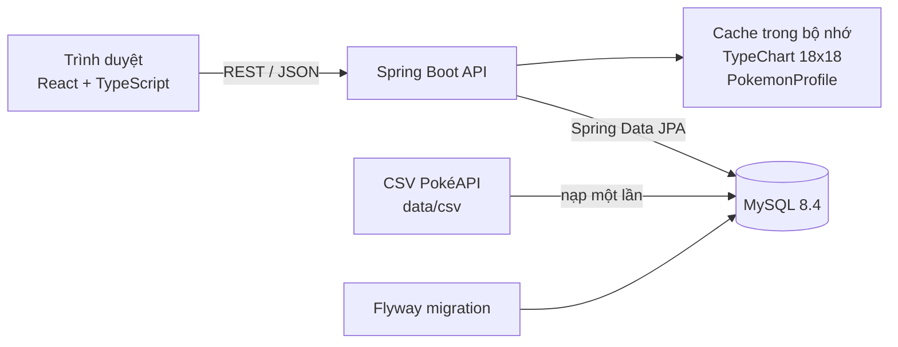

# PokeNexus - Kiến trúc hệ thống

- Phiên bản: 0.1
- Các quyết định quan trọng được ghi chi tiết trong [adr/](adr).

---

## Phần 1. Tổng quan

### I. Sơ đồ thành phần



### II. Nguyên tắc kiến trúc

- **Dữ liệu offline:** dữ liệu Pokémon được nạp một lần từ CSV vào MySQL; ứng dụng không gọi PokéAPI lúc chạy ([ADR 0002](adr/0002-offline-data-from-csv.md)).
- **Tính toán trong bộ nhớ:** dữ liệu tĩnh nhỏ (khoảng 1.300 Pokémon x 18 hệ) nên được nạp vào RAM khi khởi động để thuật toán chạy nhanh ([ADR 0003](adr/0003-in-memory-synergy.md)).
- **Monorepo:** backend, frontend, tài liệu nằm chung một repo ([ADR 0001](adr/0001-monorepo.md)).

---

## Phần 2. Công nghệ

### I. Bảng phiên bản

| Thành phần | Lựa chọn | Ghi chú |
|---|---|---|
| Ngôn ngữ backend | Java 25 (LTS) | [ADR 0004](adr/0004-java-25-spring-boot-4.md) |
| Framework | Spring Boot 4.1.x | Spring Framework 7, Jakarta EE 11 |
| Build | Maven Wrapper (`mvnw`) | Không cần cài Maven trên máy |
| Truy cập dữ liệu | Spring Data JPA (Hibernate) | Dùng Specification cho bộ lọc động |
| Migration | Flyway | Script trong `backend/src/main/resources/db/migration` |
| Tài liệu API | springdoc-openapi | Swagger UI tại `/swagger-ui.html` |
| Database | MySQL 8.4 (LTS) | `utf8mb4`, chạy bằng Docker |
| Frontend | React + TypeScript + Vite | Node.js 24 LTS |
| Giao diện | Tailwind CSS | Bảng màu hệ định nghĩa ở một nơi |
| Gọi API | TanStack Query | Cache, trạng thái tải và lỗi |
| Biểu đồ | Recharts | Radar, cột |
| CI | GitHub Actions | Xem `.github/workflows/ci.yml` |

- Phiên bản vá (patch) cụ thể chốt khi khởi tạo mã nguồn ở Tuần 2, lấy bản ổn định mới nhất tại thời điểm đó.

---

## Phần 3. Cấu trúc mã nguồn

### I. Backend (package by feature)

```text
backend/src/main/java/com/pokenexus
├── PokeNexusApplication.java
├── common        config, exception (GlobalExceptionHandler), domain (PokemonType, StatType)
├── ingestion     nạp dữ liệu CSV vào DB
├── pokedex       Omni-Dex, chi tiết, so sánh
├── typechart     bảng tương khắc
├── synergy       phân tích đội và đề xuất
└── team          lưu và chia sẻ đội
```

- Mỗi package tính năng chứa `controller`, `service`, `repository`, `entity`, `dto` của riêng nó.
- Luồng xử lý: Controller -> Service -> Repository. DTO dùng `record`, không trả Entity ra ngoài Service.

### II. Frontend

```text
frontend/src
├── app           router, providers, layout
├── pages         DexPage, PokemonDetailPage, TypeChartPage, ComparePage, TeamBuilderPage, SharedTeamPage
├── features      dex, compare, team-builder (api.ts, hooks.ts, components/)
├── components    thành phần giao diện dùng chung (TypeBadge, StatBar, Skeleton)
├── lib           http client, typeColors, formatters
└── stores        trạng thái đội đang xây
```

---

## Phần 4. Thuật toán Synergy Analyzer

### I. Thang điểm phòng thủ

| Hệ số chịu đòn | 0 (miễn nhiễm) | 0.25 | 0.5 | 1 | 2 | 4 |
|---|---|---|---|---|---|---|
| `defenseScore` | +3 | +2 | +1 | 0 | -1 | -2 |

- Hệ số hệ kép bằng tích hai hệ số đơn (ví dụ Fire/Flying chịu Rock: 2 x 2 = 4).
- `defenseScore` của mọi Pokémon với 18 hệ được tính sẵn khi khởi động.

### II. Phân tích đội

```text
FOR mỗi hệ tấn công a:
    weakness[a]   = tổng (-defenseScore) của các thành viên có điểm âm
    resistance[a] = số thành viên có defenseScore > 0
    pressure[a]   = max(0, weakness[a] - resistance[a])
    criticalHole[a] = weakness[a] >= 2 AND resistance[a] == 0

teamScore = clamp(100 - 4 * SUM(pressure) - 8 * COUNT(criticalHole), 0, 100)
```

- Độ phức tạp `O(18 x n)` với `n <= 5`.

### III. Đề xuất vị trí tiếp theo

| Thành phần | Trọng số | Cách tính |
|---|---|---|
| Phòng thủ | 60% | Cộng `pressure[a] x s` khi ứng viên kháng hệ `a`; trừ `(1 + pressure[a]) x (-s)` khi ứng viên yếu hệ `a` |
| Độ phủ tấn công | 25% | Số hệ đội chưa đánh siêu hiệu quả mà ứng viên đánh được bằng hệ của nó |
| Chỉ số | 15% | Tổng chỉ số gốc của ứng viên |

- Mỗi thành phần được chuẩn hóa về 0-1 theo giá trị lớn nhất trong tập ứng viên trước khi cộng trọng số.
- Sắp xếp giảm dần, chỉ giữ ứng viên điểm cao nhất của mỗi tổ hợp hệ để 3 đề xuất khác nhau.
- Độ phức tạp `O(N x 18 + N log N)` với `N` khoảng 1.300.
- Hệ số và trọng số là heuristic, được tinh chỉnh bằng các đội thử nghiệm trong [spec.md](spec.md), Phần 2, mục V.4.

---

## Phần 5. Cấu hình và môi trường

### I. Biến môi trường

| Biến | Dùng bởi | Ý nghĩa |
|---|---|---|
| `DB_HOST`, `DB_PORT`, `DB_NAME`, `DB_USERNAME`, `DB_PASSWORD` | Backend, Docker | Kết nối MySQL |
| `DB_ROOT_PASSWORD` | Docker | Mật khẩu root của container MySQL |
| `SPRING_PROFILES_ACTIVE` | Backend | `dev` hoặc `prod` |
| `CORS_ALLOWED_ORIGINS` | Backend | Origin của frontend được phép gọi API |
| `VITE_API_BASE_URL` | Frontend | Địa chỉ API |

- Mẫu đầy đủ ở `.env.example`. Giá trị thật đặt trong `.env` (không commit) hoặc trên nền tảng hosting.

### II. Môi trường

| Môi trường | Mô tả |
|---|---|
| Local | MySQL trong Docker; backend và frontend chạy trực tiếp trên máy |
| Production | Frontend build tĩnh; backend chạy bằng Docker image; MySQL được quản lý bởi nhà cung cấp hosting |
