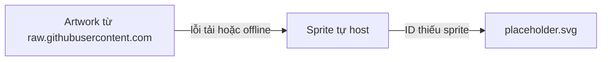

# PokeNexus - Kế hoạch quản lý Assets

- Phiên bản: 0.6 (cập nhật 2026-10-28; bộ nhiều ảnh cho mỗi khung cảnh, cỡ 1920 và 960, ngân sách 25 MB theo [ADR 0006](adr/0006-animated-scene-backdrops.md))
- Chiến lược ảnh Pokémon: **Hybrid**. Sprite nhỏ được tự host; artwork lớn lấy từ đường dẫn công khai, có fallback ([ADR 0005](adr/0005-hybrid-image-assets.md)).
- Dữ liệu CSV không thuộc phạm vi tài liệu này: xem [data/README.md](../data/README.md).

---

## Phần 1. Danh mục assets

### I. Bảng tổng hợp

| Asset | Nguồn | Định dạng, kích thước | Nơi lưu | Commit | Task |
|---|---|---|---|---|---|
| Sprite Pokémon | `PokeAPI/sprites`, `sprites/pokemon/{id}.png` | PNG 96 x 96, 0,5-1,7 KB mỗi file | `frontend/public/sprites/pokemon/` | Có | T207 |
| Artwork Pokémon | `PokeAPI/sprites`, `sprites/pokemon/other/official-artwork/{id}.png` | PNG 475 x 475, 120-145 KB mỗi file | Không lưu, tải lúc hiển thị | Không | T303 |
| Ảnh dự phòng | Tự vẽ | SVG, dưới 2 KB | `frontend/public/sprites/placeholder.svg` | Có | T207 |
| Ảnh khung cảnh (scene) | Ảnh chụp từ game Pokémon 3D: Bulbagarden Archives và trang chính thức của game ([design-system.md](design-system.md), Phần 4) | WebP 1920 x 1080 (tối đa 260 KB) và 960 x 540 (tối đa 80 KB), 1-5 ảnh mỗi scene; số liệu hiện tại ở `SOURCES.md` | `frontend/public/scenes/`, nguồn từng ảnh ở `SOURCES.md` | Có | T301 |
| Font | Dela Gothic One (`@fontsource/dela-gothic-one`), Nunito và Pixelify Sans (`@fontsource-variable/...`) | WOFF2; Dela Gothic One weight 400, hai font còn lại dạng variable | `node_modules`, Vite đóng gói vào `dist/assets` | Không (chỉ `package.json`) | T203, T301 |
| Logo, favicon | Tự thiết kế | SVG | `frontend/src/assets/logo.svg`, `frontend/public/favicon.svg` | Có | T203 |
| Ảnh xem trước link (Open Graph) | Chụp và thiết kế | PNG 1200 x 630, dưới 300 KB | `frontend/public/og-image.png` | Có | T405 |
| Ảnh chụp màn hình cho README | Chụp từ bản production | PNG hoặc WebP, rộng tối đa 1600 px, dưới 500 KB | `docs/images/` | Có | T405 |
| Sơ đồ kiến trúc dạng ảnh | Xuất từ Mermaid trong `docs/` | PNG hoặc SVG | `docs/images/` | Có | T405 |
| Wireframe | Công cụ vẽ (Excalidraw, Figma...) | PNG kèm file nguồn nếu có | `docs/wireframes/` | Có | T103 |
| Icon hệ | | | Không dùng ở MVP; nhãn hệ chỉ dùng chữ | | |

- Số liệu dung lượng sprite và artwork lấy từ kiểm tra thực tế 5 sprite và 2 artwork ngày 2026-10-19.
- Ước tính: khoảng 1.300 sprite, tổng 1,5-3 MB. Toàn bộ artwork khoảng 170 MB, đây là lý do artwork không được tự host.

---

## Phần 2. Quy tắc đặt tên và thư mục

### I. Quy tắc

| Loại | Quy tắc | Ví dụ |
|---|---|---|
| Sprite | ID PokéAPI, không thêm số 0 ở đầu | `sprites/pokemon/6.png`, `sprites/pokemon/10034.png` |
| Ảnh khung cảnh | `{scene}-{n}-{rộng}.webp`, `scene` là mã trong `src/lib/scenes.ts`, `n` là số thứ tự ảnh từ 1 | `scenes/grassland-1-1920.webp`, `scenes/grassland-1-960.webp` |
| Ảnh nhỏ khung cảnh | `{scene}-thumb.webp`, 400 x 600, cắt dọc giữa ảnh 1 bản 1920; chỉ có cho 13 địa hình, sinh URL qua `sceneThumbUrl` | `scenes/volcano-thumb.webp` |
| Ảnh trong `docs/images/` | `<trang>-<thiết bị>.<đuôi>`, chữ thường, gạch nối | `dex-desktop.png`, `team-builder-mobile.png` |
| Sơ đồ | `diagram-<tên>.<đuôi>` | `diagram-container.svg` |
| Wireframe | `<trang>-<thiết bị>.png` | `pokemon-detail-mobile.png` |
| Asset trong `src/assets/` | `kebab-case` | `logo.svg` |

- `public/` chứa file phục vụ nguyên tên (sprite, favicon, ảnh OG). `src/assets/` chứa file được import trong code, Vite sẽ gắn hash vào tên file khi build.

---

## Phần 3. Ngân sách dung lượng

### I. Giới hạn

| Hạng mục | Giới hạn | Hành động khi vượt |
|---|---|---|
| Thư mục sprite | 15 MB | Chuyển sang tải sprite bằng script lúc build, không commit |
| Thư mục ảnh khung cảnh | 25 MB (15 scene x tối đa 5 ảnh x 2 cỡ) | Giảm chất lượng WebP trước, sau đó bớt ảnh; không bớt scene |
| Một ảnh trong `docs/images/` | 500 KB | Giảm kích thước hoặc chuyển sang WebP |
| Một file bất kỳ trong repo | 10 MB | Không commit; đặt ở nơi lưu trữ ngoài và dẫn link |
| Font tải về khi mở trang | 3 họ font, chỉ WOFF2; chỉ import subset `latin`, `latin-ext`, `vietnamese` của Dela Gothic One | Bỏ subset không dùng |
| JS bundle ban đầu | 300 KB sau gzip | Tách code theo route bằng `lazy()` |

- GitHub cảnh báo khi đẩy file trên 50 MB và chặn file trên 100 MB; dự án không dùng Git LFS vì mọi asset đều nằm dưới các giới hạn trên.
- PNG, JPG, WebP, MP4 đã được khai báo `binary` trong `.gitattributes`. SVG là văn bản, giữ nguyên quy tắc `eol=lf`.

---

## Phần 4. Quy trình tải sprite (T207)

### I. Các bước của script `scripts/download-sprites.sh`

- Chạy trong Git Bash từ thư mục gốc: `bash scripts/download-sprites.sh`. Lần chạy ngày 2026-10-23: 1342 file tải mới, 9 ID thiếu, 1,5 MB, khoảng 3,5 phút.

- Đọc danh sách ID từ cột `id` của `data/csv/pokemon.csv` (cần tải CSV trước).
- Với mỗi ID, tải `https://raw.githubusercontent.com/PokeAPI/sprites/master/sprites/pokemon/{id}.png` vào `frontend/public/sprites/pokemon/{id}.png`.
- Bỏ qua file đã tồn tại để chạy lại được nhiều lần.
- Tải tuần tự hoặc tối đa 4 luồng song song, thử lại 2 lần khi lỗi mạng, để không gửi dồn dập request tới GitHub.
- ID trả 404 (một số dạng không có sprite) được ghi vào `frontend/public/sprites/missing.txt`; frontend dùng ảnh dự phòng cho các ID này.
- In tóm tắt khi chạy xong: số file tải mới, số file bỏ qua, số ID thiếu, tổng dung lượng thư mục.

### II. Kiểm tra sau khi tải

- Số file cộng số ID thiếu bằng số dòng dữ liệu của `pokemon.csv`.
- Tổng dung lượng thư mục dưới 15 MB.
- Mở thử `6.png`, `445.png`, `10034.png` đúng hình.

### III. Cập nhật

- Chạy lại script khi cập nhật bộ CSV (có Pokémon mới), sau đó commit các file mới trong một PR loại `chore(assets)`.

---

## Phần 5. Hiển thị và fallback

### I. Hàm sinh URL (`src/lib/assets.ts`)

| Hàm | Kết quả |
|---|---|
| `getSpriteUrl(id)` | `/sprites/pokemon/{id}.png` |
| `getArtworkUrl(id)` | `https://raw.githubusercontent.com/PokeAPI/sprites/master/sprites/pokemon/other/official-artwork/{id}.png` |
| `PLACEHOLDER_URL` | `/sprites/placeholder.svg` |
| `sceneUrl(scene, photo, width)` | `/scenes/{scene}-{photo}-{width}.webp`, `width` thuộc `SCENE_WIDTHS` (960, 1920) |
| `sceneSrcSet(scene, photo)` | Chuỗi `srcset` hai cỡ 960w, 1920w của một ảnh |

- Đây là nơi duy nhất trong code chứa đường dẫn ảnh. Khi đổi nguồn ảnh thì chỉ sửa file này.

### II. Nơi dùng từng loại ảnh

| Vị trí | Loại ảnh | Kích thước hiển thị |
|---|---|---|
| Lưới Omni-Dex, kết quả tìm kiếm, slot đội, thẻ đề xuất, trang đội chia sẻ | Sprite | 96 px (lưới), 48 px (tìm kiếm) |
| Trang chi tiết, Bàn Cân | Artwork | 240 px mobile, 320 px desktop |
| `PageHero` của mọi trang | Ảnh khung cảnh qua `SceneBackdrop` (`srcset` 960w, 1920w) | Tràn ngang, cao 192 px mobile, 320 px desktop |

### III. Chuỗi fallback trong `PokemonSprite`

- Sprite hiển thị với `image-rendering: pixelated` để ảnh pixel không bị nhòe khi phóng to.
- Luôn đặt `width` và `height` để trang không bị nhảy bố cục khi ảnh tải xong; dùng `loading="lazy"` cho ảnh trong lưới.
- Khi demo không có mạng: sprite và font vẫn hiển thị; artwork tự chuyển sang sprite.

---

## Phần 6. Cache

### I. Chính sách

| Loại file | `Cache-Control` đề xuất | Lý do |
|---|---|---|
| `dist/assets/*` (JS, CSS, font, logo có hash) | `public, max-age=31536000, immutable` | Tên file đổi khi nội dung đổi |
| `/sprites/**` | `public, max-age=604800` | Tên file cố định, hiếm khi đổi |
| `index.html` | `no-cache` | Luôn lấy phiên bản mới nhất |

- Cấu hình header theo cách của nền tảng static hosting được chọn ở T403 (file cấu hình header hoặc thiết lập trên giao diện).
- Artwork do GitHub phục vụ; dự án không kiểm soát header của nguồn này.

---

## Phần 7. Giấy phép và ghi nguồn

### I. Tình trạng giấy phép

| Asset | Giấy phép | Nghĩa vụ |
|---|---|---|
| Repo `PokeAPI/sprites` | CC0 1.0 cho repo; file `LICENCE.txt` ghi rõ nội dung hình ảnh thuộc bản quyền The Pokémon Company | Ghi nguồn PokéAPI; nêu rõ bản quyền hình ảnh; chỉ dùng phi thương mại |
| Dữ liệu `PokeAPI/pokeapi` | Giấy phép dạng BSD trong `LICENSE.md` của repo; tên Pokémon là thương hiệu của Nintendo | Giữ thông báo bản quyền khi phân phối lại dữ liệu |
| Dela Gothic One, Nunito, Pixelify Sans | SIL Open Font License 1.1 | Được đóng gói và phân phối cùng ứng dụng |
| Ảnh khung cảnh chụp từ game | Bản quyền Nintendo, Game Freak, The Pokémon Company | Chỉ dùng phi thương mại; ghi nguồn từng ảnh trong `frontend/public/scenes/SOURCES.md` |
| Logo, placeholder, ảnh chụp | Tự tạo, theo giấy phép MIT của dự án | |

- Không dùng logo Pokémon chính thức, hình Poké Ball hay font thương hiệu trong logo PokeNexus.
- Footer của ứng dụng và README Phần 9 ghi: nguồn dữ liệu PokéAPI; Pokémon là thương hiệu của Nintendo, Game Freak, The Pokémon Company; dự án phi thương mại.
- Kiểm tra lại các file giấy phép ở trên trước khi gắn tag `v1.0.0`, vì nội dung có thể thay đổi.

---

## Phần 8. Checklist

- Asset mới có trong bảng Phần 1 (nguồn, nơi lưu, có commit hay không).
- Tên file theo Phần 2; dung lượng trong giới hạn Phần 3.
- Ảnh trong UI có `alt` phù hợp ([design-system.md](design-system.md), Phần 7).
- Asset bên thứ ba đã kiểm tra giấy phép và ghi nguồn.
- Ảnh khung cảnh đã xóa HUD hoặc người thừa: ghi công cụ trong `SOURCES.md` và đã chạy `node scripts/check-image-provenance.mjs` trên file sửa ([design-system.md](design-system.md), Phần 4, mục I).
