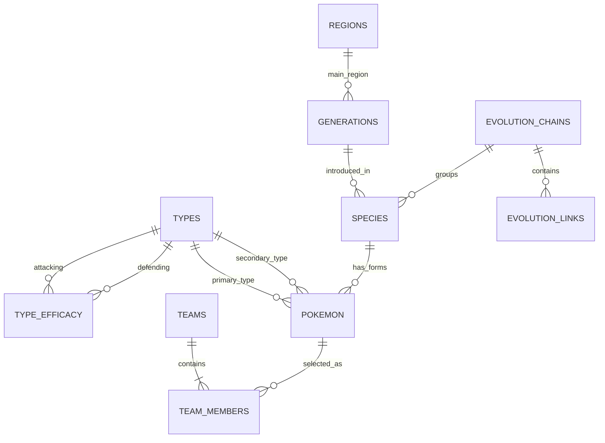

# PokéNexus - Thiết kế cơ sở dữ liệu

- Phiên bản: 0.1 (phạm vi MVP)
- Hệ quản trị: MySQL 8.4, bộ mã `utf8mb4`.
- Schema được tạo bằng Flyway; tài liệu này là nguồn tham chiếu khi viết migration.

---

## Phần 1. Nguyên tắc thiết kế

### I. Tách Species và Pokemon

- `species` lưu thông tin loài: thế hệ, chuỗi tiến hóa, huyền thoại.
- `pokemon` lưu một dạng cụ thể có hệ và chỉ số riêng (ví dụ Vulpix thường là Fire, Vulpix vùng Alola là Ice).
- Quan hệ: một species có nhiều pokemon.

### II. Tối ưu kiểu dữ liệu

| Trường | Kiểu | Lý do |
|---|---|---|
| Chỉ số gốc | `TINYINT UNSIGNED` | Tối đa 255 |
| ID Pokémon (kể cả dạng đặc biệt trên 10.000) | `SMALLINT UNSIGNED` | Tối đa 65.535 |
| Hệ số sát thương | `TINYINT UNSIGNED` (0, 50, 100, 200) | Số nguyên, khớp định dạng CSV nguồn |
| `base_stat_total` | Cột sinh tự động `STORED`, có index | Lọc và sắp xếp nhanh |

### III. Ràng buộc đội hình

- `team_members` có khóa chính kép `(team_id, slot)` và `CHECK (slot BETWEEN 1 AND 6)`.
- `UNIQUE (team_id, pokemon_id)`: một đội không có hai Pokémon trùng nhau.
- Xóa đội thì xóa luôn thành viên (`ON DELETE CASCADE`).

---

## Phần 2. Sơ đồ quan hệ (MVP)

### I. ERD

---

## Phần 3. Từ điển dữ liệu

### I. Nhóm dữ liệu tĩnh

#### 1. `types`

| Cột | Kiểu | Ràng buộc | Ghi chú |
|---|---|---|---|
| `id` | `TINYINT UNSIGNED` | PK | Khớp ID của PokéAPI (1 = normal ... 18 = fairy) |
| `name` | `VARCHAR(20)` | NOT NULL, UNIQUE | |

#### 2. `type_efficacy`

| Cột | Kiểu | Ràng buộc | Ghi chú |
|---|---|---|---|
| `attacking_type_id` | `TINYINT UNSIGNED` | PK, FK -> `types` | |
| `defending_type_id` | `TINYINT UNSIGNED` | PK, FK -> `types` | |
| `damage_factor` | `TINYINT UNSIGNED` | NOT NULL | 0, 50, 100, 200 |

- Đủ 324 dòng (18 x 18).

#### 3. `regions`, `generations`

| Bảng | Cột chính | Ghi chú |
|---|---|---|
| `regions` | `id TINYINT UNSIGNED` PK, `name VARCHAR(30)` UNIQUE | |
| `generations` | `id TINYINT UNSIGNED` PK, `name VARCHAR(30)`, `region_id` FK -> `regions` | |

#### 4. `evolution_chains`, `evolution_links`

| Cột (`evolution_links`) | Kiểu | Ràng buộc | Ghi chú |
|---|---|---|---|
| `id` | `INT UNSIGNED` | PK, AUTO_INCREMENT | |
| `chain_id` | `SMALLINT UNSIGNED` | FK -> `evolution_chains`, INDEX | |
| `from_species_id` | `SMALLINT UNSIGNED` | FK -> `species` | |
| `to_species_id` | `SMALLINT UNSIGNED` | FK -> `species` | |
| `trigger_name` | `VARCHAR(30)` | NOT NULL | level-up, use-item, trade... |
| `min_level` | `TINYINT UNSIGNED` | NULL | |
| `item_name` | `VARCHAR(50)` | NULL | |

- `evolution_chains` chỉ có cột `id SMALLINT UNSIGNED` PK; dùng để nhóm các loài cùng chuỗi.

#### 5. `species`

| Cột | Kiểu | Ràng buộc | Ghi chú |
|---|---|---|---|
| `id` | `SMALLINT UNSIGNED` | PK | Số Pokédex quốc gia |
| `name` | `VARCHAR(50)` | NOT NULL, UNIQUE | |
| `generation_id` | `TINYINT UNSIGNED` | FK -> `generations`, INDEX | |
| `evolution_chain_id` | `SMALLINT UNSIGNED` | FK -> `evolution_chains`, NULL | |
| `is_legendary` | `BOOLEAN` | NOT NULL, mặc định FALSE | |
| `is_mythical` | `BOOLEAN` | NOT NULL, mặc định FALSE | |
| `is_fully_evolved` | `BOOLEAN` | NOT NULL, mặc định TRUE | Tính khi nạp dữ liệu |

#### 6. `pokemon`

| Cột | Kiểu | Ràng buộc | Ghi chú |
|---|---|---|---|
| `id` | `SMALLINT UNSIGNED` | PK | ID của PokéAPI |
| `species_id` | `SMALLINT UNSIGNED` | FK -> `species` | |
| `name` | `VARCHAR(60)` | NOT NULL, UNIQUE | Ví dụ `rotom-wash` |
| `primary_type_id` | `TINYINT UNSIGNED` | FK -> `types`, INDEX | |
| `secondary_type_id` | `TINYINT UNSIGNED` | FK -> `types`, NULL, INDEX | |
| `hp`, `attack`, `defense`, `special_attack`, `special_defense`, `speed` | `TINYINT UNSIGNED` | NOT NULL | `speed` có INDEX |
| `base_stat_total` | `SMALLINT UNSIGNED` | GENERATED STORED, INDEX | Tổng 6 chỉ số |
| `height_dm` | `SMALLINT UNSIGNED` | NOT NULL | Đơn vị decimet (theo nguồn) |
| `weight_hg` | `SMALLINT UNSIGNED` | NOT NULL | Đơn vị hectogam (theo nguồn) |
| `sprite_url` | `VARCHAR(255)` | NULL | |
| `is_default` | `BOOLEAN` | NOT NULL, mặc định TRUE | Dạng mặc định của loài |

### II. Nhóm dữ liệu người dùng

#### 1. `teams`

| Cột | Kiểu | Ràng buộc | Ghi chú |
|---|---|---|---|
| `id` | `BIGINT UNSIGNED` | PK, AUTO_INCREMENT | |
| `user_id` | `BIGINT UNSIGNED` | NULL | Để trống trong MVP; dành cho tính năng đăng nhập sau này |
| `name` | `VARCHAR(60)` | NOT NULL | |
| `share_code` | `CHAR(8)` | NOT NULL, UNIQUE | Mã chia sẻ |
| `synergy_score` | `DECIMAL(5,2)` | NULL | Điểm tại thời điểm lưu |
| `created_at` | `DATETIME` | NOT NULL, mặc định thời điểm tạo | |
| `updated_at` | `DATETIME` | NOT NULL, tự cập nhật | |

#### 2. `team_members`

| Cột | Kiểu | Ràng buộc | Ghi chú |
|---|---|---|---|
| `team_id` | `BIGINT UNSIGNED` | PK, FK -> `teams` ON DELETE CASCADE | |
| `slot` | `TINYINT UNSIGNED` | PK, CHECK 1-6 | |
| `pokemon_id` | `SMALLINT UNSIGNED` | FK -> `pokemon`, UNIQUE cùng `team_id` | |
| `nickname` | `VARCHAR(30)` | NULL | |

---

## Phần 4. Mở rộng sau MVP

### I. Bảng dự kiến

| Bảng | Phục vụ |
|---|---|
| `users`, `favorites` | Đăng nhập, danh sách yêu thích |
| `abilities`, `pokemon_abilities` | Ability và các ngoại lệ miễn nhiễm |
| `moves`, `pokemon_moves`, `team_member_moves` | Chiêu thức, độ phủ tấn công thực tế |
| `gym_leaders`, `gym_leader_pokemon` | World Explorer |
