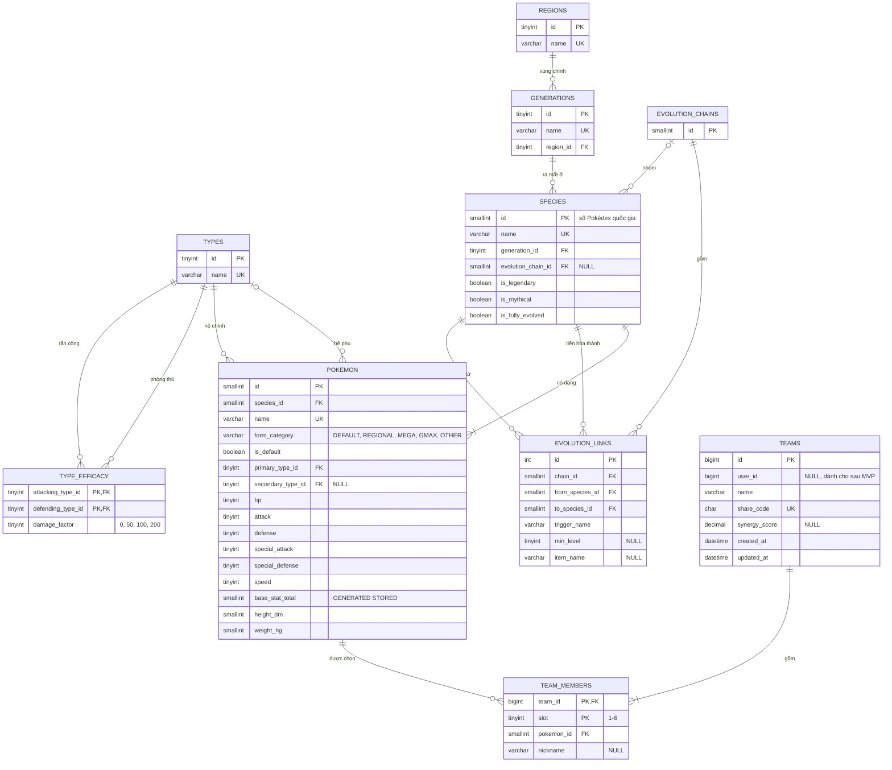

# PokeNexus - Thiết kế cơ sở dữ liệu

- Phiên bản: 0.3 (phạm vi MVP, cập nhật 2026-10-21; chỉnh quy tắc `form_category` và chọn dòng tiến hóa theo khảo sát T102)
- Hệ quản trị: MySQL 8.4, bộ mã `utf8mb4`, collation `utf8mb4_0900_ai_ci`.
- Schema được tạo bằng Flyway; tài liệu này là nguồn tham chiếu khi viết migration.
- Thay đổi so với 0.1: thêm cột `pokemon.form_category`; bỏ `pokemon.sprite_url` (URL ảnh sinh từ ID ở frontend, xem [ADR 0005](adr/0005-hybrid-image-assets.md)); thêm Phần 4 (index) và Phần 5 (migration, ingestion).

---

## Phần 1. Nguyên tắc thiết kế

### I. Tách Species và Pokemon

- `species` lưu thông tin loài: thế hệ, chuỗi tiến hóa, huyền thoại.
- `pokemon` lưu một dạng cụ thể có hệ và chỉ số riêng (ví dụ Vulpix thường là Fire, Vulpix vùng Alola là Ice).
- Quan hệ: một species có nhiều pokemon.

### II. Hệ và chỉ số lưu trực tiếp trên `pokemon`

- Mỗi Pokémon có đúng 1-2 hệ và đúng 6 chỉ số, nên lưu thành cột (`primary_type_id`, `secondary_type_id`, `hp`...) thay vì bảng nối.
- Lợi ích: lọc và sắp xếp bằng một truy vấn không JOIN; Entity đơn giản.
- Đánh đổi: không mở rộng được khi có "hệ thứ 3"; chấp nhận vì luật game không có trường hợp này.

### III. Tối ưu kiểu dữ liệu

| Trường | Kiểu | Lý do |
|---|---|---|
| Chỉ số gốc | `TINYINT UNSIGNED` | Tối đa 255 |
| ID Pokémon (kể cả dạng đặc biệt trên 10.000) | `SMALLINT UNSIGNED` | Tối đa 65.535 |
| Hệ số sát thương | `TINYINT UNSIGNED` (0, 50, 100, 200) | Số nguyên, khớp định dạng CSV nguồn |
| `base_stat_total` | Cột sinh tự động `STORED`, có index | Lọc và sắp xếp nhanh |
| `form_category` | `VARCHAR(10)` + `CHECK` | Dễ đọc khi truy vấn tay; Entity ánh xạ sang enum `FormCategory` bằng `@Enumerated(EnumType.STRING)` |

### IV. Phân loại dạng (form)

| `form_category` | Quy tắc suy ra từ `pokemon.csv` | Ví dụ | Hiện ở Omni-Dex mặc định |
|---|---|---|---|
| `DEFAULT` | `is_default = 1` | `charizard` | Có |
| `OTHER` | Tên chứa `-totem` hoặc kết thúc bằng `-cap` | `raticate-totem-alola`, `pikachu-alola-cap` | Không |
| `REGIONAL` | Tên chứa `-alola`, `-galar`, `-hisui` hoặc `-paldea` | `vulpix-alola` | Có |
| `MEGA` | Tên chứa `-mega` | `charizard-mega-x` | Không |
| `GMAX` | Tên kết thúc bằng `-gmax` | `charizard-gmax` | Không |
| `OTHER` | Các trường hợp còn lại | `rotom-wash`, `kyogre-primal` | Không |

- Quy tắc áp dụng theo thứ tự từ trên xuống, dừng ở quy tắc khớp đầu tiên. Đã xác nhận bằng khảo sát T102 (2026-10-21): dòng `OTHER` thứ hai đứng trước `REGIONAL` để dạng totem và Pikachu đội mũ không bị tính là dạng vùng miền.
- Số dạng kỳ vọng với bộ CSV ngày 2026-10-21: `DEFAULT` 1025, `REGIONAL` 58, `MEGA` 97, `GMAX` 34, `OTHER` 137 (tổng 1351). Dạng Primal xếp `OTHER`.
- Team Builder nhận mọi dạng; tập ứng viên để đề xuất chỉ gồm `DEFAULT` và `REGIONAL` (quyết định ở [spec.md](spec.md), Phần 5).

### V. Ràng buộc đội hình

- `team_members` có khóa chính kép `(team_id, slot)` và `CHECK (slot BETWEEN 1 AND 6)`.
- `UNIQUE (team_id, pokemon_id)`: một đội không có hai Pokémon trùng nhau.
- Xóa đội thì xóa luôn thành viên (`ON DELETE CASCADE`).

---

## Phần 2. Sơ đồ thực thể liên kết (ERD)

### I. Sơ đồ đầy đủ (MVP)



- Kiểu số trong sơ đồ đều là `UNSIGNED`; kiểu đầy đủ (độ dài `VARCHAR`, `CHAR`, `DECIMAL`) ghi ở Phần 3.

### II. Nhóm bảng

| Nhóm | Bảng | Nguồn dữ liệu | Ghi |
|---|---|---|---|
| Tham chiếu | `types`, `type_efficacy`, `regions`, `generations` | CSV, nạp một lần | Chỉ đọc |
| Bách khoa | `evolution_chains`, `evolution_links`, `species`, `pokemon` | CSV, nạp một lần | Chỉ đọc |
| Người dùng | `teams`, `team_members` | API `POST /api/v1/teams` | Đọc và ghi |

---

## Phần 3. Từ điển dữ liệu

### I. Nhóm dữ liệu tĩnh

#### 1. `types`

| Cột | Kiểu | Ràng buộc | Ghi chú |
|---|---|---|---|
| `id` | `TINYINT UNSIGNED` | PK | Khớp ID của PokéAPI (1 = normal ... 18 = fairy) |
| `name` | `VARCHAR(20)` | NOT NULL, UNIQUE | |

#### 2. `type_efficacy`

| Cột | Kiểu | Ràng buộc | Ghi chú |
|---|---|---|---|
| `attacking_type_id` | `TINYINT UNSIGNED` | PK, FK -> `types` | |
| `defending_type_id` | `TINYINT UNSIGNED` | PK, FK -> `types` | |
| `damage_factor` | `TINYINT UNSIGNED` | NOT NULL, CHECK IN (0, 50, 100, 200) | |

- Đủ 324 dòng (18 x 18).

#### 3. `regions`, `generations`

| Bảng | Cột chính | Ghi chú |
|---|---|---|
| `regions` | `id TINYINT UNSIGNED` PK, `name VARCHAR(30)` UNIQUE | |
| `generations` | `id TINYINT UNSIGNED` PK, `name VARCHAR(30)` UNIQUE, `region_id` FK -> `regions` | |

#### 4. `evolution_chains`, `evolution_links`

| Cột (`evolution_links`) | Kiểu | Ràng buộc | Ghi chú |
|---|---|---|---|
| `id` | `INT UNSIGNED` | PK, AUTO_INCREMENT | |
| `chain_id` | `SMALLINT UNSIGNED` | FK -> `evolution_chains`, INDEX | |
| `from_species_id` | `SMALLINT UNSIGNED` | FK -> `species` | |
| `to_species_id` | `SMALLINT UNSIGNED` | FK -> `species`, UNIQUE | Mỗi loài chỉ có một dòng tiến hóa mặc định |
| `trigger_name` | `VARCHAR(30)` | NOT NULL | level-up, use-item, trade... |
| `min_level` | `TINYINT UNSIGNED` | NULL | |
| `item_name` | `VARCHAR(50)` | NULL | |

- `evolution_chains` chỉ có cột `id SMALLINT UNSIGNED` PK; dùng để nhóm các loài cùng chuỗi.

#### 5. `species`

| Cột | Kiểu | Ràng buộc | Ghi chú |
|---|---|---|---|
| `id` | `SMALLINT UNSIGNED` | PK | Số Pokédex quốc gia |
| `name` | `VARCHAR(50)` | NOT NULL, UNIQUE | |
| `generation_id` | `TINYINT UNSIGNED` | FK -> `generations`, INDEX | |
| `evolution_chain_id` | `SMALLINT UNSIGNED` | FK -> `evolution_chains`, NULL | |
| `is_legendary` | `BOOLEAN` | NOT NULL, mặc định FALSE | |
| `is_mythical` | `BOOLEAN` | NOT NULL, mặc định FALSE | |
| `is_fully_evolved` | `BOOLEAN` | NOT NULL, mặc định TRUE | Tính khi nạp dữ liệu |

#### 6. `pokemon`

| Cột | Kiểu | Ràng buộc | Ghi chú |
|---|---|---|---|
| `id` | `SMALLINT UNSIGNED` | PK | ID của PokéAPI, cũng là tên file sprite |
| `species_id` | `SMALLINT UNSIGNED` | FK -> `species`, INDEX | |
| `name` | `VARCHAR(60)` | NOT NULL, UNIQUE | Ví dụ `rotom-wash` |
| `form_category` | `VARCHAR(10)` | NOT NULL, CHECK IN (`DEFAULT`, `REGIONAL`, `MEGA`, `GMAX`, `OTHER`), INDEX | Phần 1, mục IV |
| `is_default` | `BOOLEAN` | NOT NULL, mặc định TRUE | Dạng mặc định của loài |
| `primary_type_id` | `TINYINT UNSIGNED` | FK -> `types`, INDEX | |
| `secondary_type_id` | `TINYINT UNSIGNED` | FK -> `types`, NULL, INDEX | Khác `primary_type_id` |
| `hp`, `attack`, `defense`, `special_attack`, `special_defense`, `speed` | `TINYINT UNSIGNED` | NOT NULL | `speed` có INDEX |
| `base_stat_total` | `SMALLINT UNSIGNED` | GENERATED STORED, INDEX | Tổng 6 chỉ số |
| `height_dm` | `SMALLINT UNSIGNED` | NOT NULL | Đơn vị decimet (theo nguồn) |
| `weight_hg` | `SMALLINT UNSIGNED` | NOT NULL | Đơn vị hectogam (theo nguồn) |

### II. Nhóm dữ liệu người dùng

#### 1. `teams`

| Cột | Kiểu | Ràng buộc | Ghi chú |
|---|---|---|---|
| `id` | `BIGINT UNSIGNED` | PK, AUTO_INCREMENT | Không lộ ra API |
| `user_id` | `BIGINT UNSIGNED` | NULL | Để trống trong MVP; dành cho tính năng đăng nhập sau này |
| `name` | `VARCHAR(60)` | NOT NULL | |
| `share_code` | `CHAR(8)` | NOT NULL, UNIQUE | Base62, sinh bằng `SecureRandom`; collation phân biệt hoa thường `utf8mb4_bin` |
| `synergy_score` | `DECIMAL(5,2)` | NULL | Điểm tại thời điểm lưu (0.00-100.00) |
| `created_at` | `DATETIME` | NOT NULL, mặc định thời điểm tạo | |
| `updated_at` | `DATETIME` | NOT NULL, tự cập nhật | |

- `share_code` phải dùng collation `utf8mb4_bin`: collation mặc định `utf8mb4_0900_ai_ci` không phân biệt hoa thường nên `a1B2c3D4` và `A1b2C3d4` sẽ bị coi là trùng.

#### 2. `team_members`

| Cột | Kiểu | Ràng buộc | Ghi chú |
|---|---|---|---|
| `team_id` | `BIGINT UNSIGNED` | PK, FK -> `teams` ON DELETE CASCADE | |
| `slot` | `TINYINT UNSIGNED` | PK, CHECK 1-6 | |
| `pokemon_id` | `SMALLINT UNSIGNED` | FK -> `pokemon`, UNIQUE cùng `team_id` | |
| `nickname` | `VARCHAR(30)` | NULL | |

---

## Phần 4. Index

### I. Danh sách index

| Bảng | Index | Cột | Phục vụ |
|---|---|---|---|
| `pokemon` | `idx_pokemon_primary_type` | `primary_type_id` | Lọc theo hệ |
| `pokemon` | `idx_pokemon_secondary_type` | `secondary_type_id` | Lọc theo hệ |
| `pokemon` | `idx_pokemon_bst` | `base_stat_total` | Lọc khoảng BST, sắp xếp |
| `pokemon` | `idx_pokemon_speed` | `speed` | Lọc tốc độ tối thiểu, sắp xếp |
| `pokemon` | `idx_pokemon_form_category` | `form_category` | Ẩn Mega, Gmax mặc định |
| `pokemon` | `idx_pokemon_species` | `species_id` | JOIN `species` (thế hệ, huyền thoại) |
| `species` | `idx_species_generation` | `generation_id` | Lọc theo thế hệ |
| `evolution_links` | `idx_evolution_links_chain` | `chain_id` | Cây tiến hóa |
| `teams` | `uk_teams_share_code` | `share_code` | Mở đội chia sẻ |
| `team_members` | `uk_team_members_pokemon` | `team_id`, `pokemon_id` | Chống trùng thành viên |

- Bảng `pokemon` khoảng 1.300 dòng nên index chủ yếu phục vụ tính đúng đắn của kế hoạch truy vấn, chưa phải nút thắt hiệu năng. Không thêm index khi chưa có truy vấn cần đến.
- Quy ước tên: `idx_<bảng>_<cột>` cho index thường, `uk_<bảng>_<cột>` cho unique, `fk_<bảng>_<bảng tham chiếu>` cho khóa ngoại.

---

## Phần 5. Migration và nạp dữ liệu

### I. Danh sách migration Flyway

| File | Nội dung |
|---|---|
| `V1__create_reference_tables.sql` | `types`, `type_efficacy`, `regions`, `generations` |
| `V2__create_pokedex_tables.sql` | `evolution_chains`, `species`, `pokemon`, `evolution_links` và index |
| `V3__create_team_tables.sql` | `teams`, `team_members` |

- Thư mục: `backend/src/main/resources/db/migration`.
- Không sửa migration đã chạy trên `main`; thay đổi schema thì tạo file `V<n+1>__mo_ta.sql`. Cách tránh trùng số phiên bản giữa hai nhánh: [git-workflow.md](git-workflow.md), Phần 5.
- Migration chỉ tạo schema. Dữ liệu tĩnh do `IngestionRunner` nạp (mục II), dữ liệu người dùng do API ghi.

### II. Quy trình nạp dữ liệu (ingestion)

| Bước | Bảng đích | File CSV | Xử lý |
|---|---|---|---|
| 1 | `types` | `types.csv` | Chỉ lấy `id` từ 1 đến 18 |
| 2 | `type_efficacy` | `type_efficacy.csv` | Chỉ lấy dòng có cả hai hệ trong 1-18; kiểm tra đủ 324 dòng |
| 3 | `regions`, `generations` | `regions.csv`, `generations.csv` | |
| 4 | `evolution_chains` | `evolution_chains.csv` | Chỉ lấy `id` |
| 5 | `species` | `pokemon_species.csv` | Tính `is_fully_evolved` |
| 6 | `pokemon` | `pokemon.csv`, `pokemon_types.csv`, `pokemon_stats.csv`, `stats.csv` | Gom hệ theo `slot`, gom 6 chỉ số; tính `form_category` |
| 7 | `evolution_links` | `pokemon_evolution.csv`, `evolution_triggers.csv`, `pokemon_species.csv` | Lấy loài gốc từ `evolves_from_species_id`; mỗi loài một dòng: chọn dòng `is_default = 1` có `id` nhỏ nhất (48 loài có nhiều dòng mặc định) |

- Chi tiết cột và lưu ý của từng file: [data/README.md](../data/README.md).
- Toàn bộ quá trình nạp chạy trong một transaction. Lỗi ở bất kỳ bước nào thì rollback và dừng ứng dụng với log nêu rõ file, dòng.
- Idempotent: chỉ nạp khi bảng `pokemon` rỗng. Bật tắt bằng thuộc tính `app.ingestion.enabled` (mặc định `true` ở profile `dev`).
- Sau khi nạp thành công lần đầu, xuất `mysqldump` vào `data/dumps/` (không commit) để dựng lại DB nhanh.

### III. Kiểm tra sau khi nạp

```sql
SELECT COUNT(*) FROM types;
SELECT COUNT(*) FROM type_efficacy;
SELECT name, hp, attack, defense, special_attack, special_defense, speed, base_stat_total
FROM pokemon WHERE name = 'charizard';
SELECT form_category, COUNT(*) FROM pokemon GROUP BY form_category;
```

- Kỳ vọng: 18; 324; Charizard 78/84/78/109/85/100, BST 534; có đủ 5 nhóm `form_category`.

---

## Phần 6. Mở rộng sau MVP

### I. Bảng dự kiến

| Bảng | Phục vụ |
|---|---|
| `users`, `favorites` | Đăng nhập, danh sách yêu thích |
| `abilities`, `pokemon_abilities` | Ability và các ngoại lệ miễn nhiễm |
| `moves`, `pokemon_moves`, `team_member_moves` | Chiêu thức, độ phủ tấn công thực tế |
| `gym_leaders`, `gym_leader_pokemon` | World Explorer |
