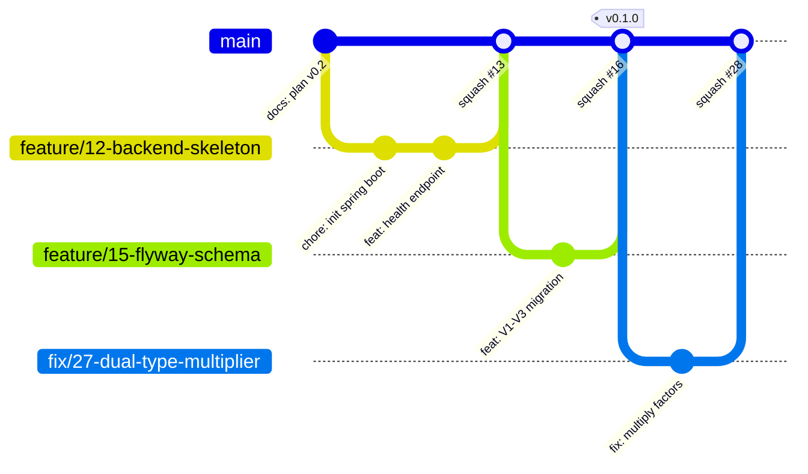
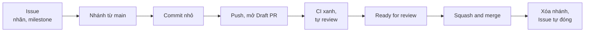

# PokeNexus - Git Workflow

- Phiên bản: 0.2 (cập nhật 2026-10-19)
- Mô hình: **GitHub Flow** với một nhánh lâu dài `main`, mọi thay đổi đi qua Pull Request và **Squash and merge**.
- Cấu hình phía GitHub (ruleset, nhãn, milestone): [github-setup.md](github-setup.md). Definition of Done: [CONTRIBUTING.md](../CONTRIBUTING.md), Phần 4.

---

## Phần 1. Mô hình nhánh

### I. Sơ đồ



### II. Lý do chọn GitHub Flow

| Mô hình | Phù hợp khi | Với PokeNexus |
|---|---|---|
| GitHub Flow (chọn) | Một người hoặc nhóm nhỏ, triển khai liên tục | Một người làm, 4 tuần, một môi trường production |
| Git Flow (`develop`, `release/*`) | Nhiều phiên bản song song, chu kỳ phát hành dài | Thừa nhánh, tốn thời gian merge |
| Trunk-based (commit thẳng `main`) | Có test tự động mạnh, feature flag | Mất bước review qua PR và lịch sử theo Issue |

### III. Quy tắc nhánh

| Quy tắc | Nội dung |
|---|---|
| `main` | Luôn build được và CI xanh; được bảo vệ, chỉ nhận thay đổi qua PR; cấm force push |
| Nhánh làm việc | Tạo từ `main` mới nhất; một nhánh cho một Issue; xóa sau khi merge |
| Tuổi thọ | Tối đa 2 ngày. Việc lớn hơn thì tách Issue (task trong roadmap đã tối đa 1 ngày) |
| Số nhánh mở cùng lúc | Tối đa 2, khớp giới hạn cột `In Progress` trên board |

### IV. Đặt tên nhánh

| Tiền tố | Dùng cho | Ví dụ |
|---|---|---|
| `feature/` | Tính năng mới | `feature/12-omni-dex-filter` |
| `fix/` | Sửa lỗi | `fix/27-dual-type-multiplier` |
| `docs/` | Chỉ thay đổi tài liệu | `docs/update-api-spec` |
| `chore/` | Cấu hình, công cụ, phụ thuộc, assets | `chore/setup-ci` |
| `refactor/` | Tái cấu trúc, không đổi hành vi | `refactor/synergy-service` |
| `test/` | Chỉ thêm hoặc sửa test | `test/synergy-edge-cases` |

- Dạng `<tiền tố>/<số Issue>-<mo-ta-ngan>`, chữ thường, gạch nối, không dấu tiếng Việt.

---

## Phần 2. Vòng đời một thay đổi

### I. Các bước



| Bước | Hành động | Cột trên board |
|---|---|---|
| 1 | Tạo hoặc chọn Issue, gắn nhãn và milestone, tự giao cho mình | `To Do` |
| 2 | Tạo nhánh từ `main` mới nhất | `In Progress` |
| 3 | Commit nhỏ theo Conventional Commits (Phần 3) | `In Progress` |
| 4 | Push, mở **Draft PR** sớm để CI chạy; mô tả có `Closes #<số>` | `In Progress` |
| 5 | CI xanh; tự review diff trên GitHub theo checklist Phần 4 | `In Review` |
| 6 | Chuyển PR sang Ready, Squash and merge | `Done` |
| 7 | Nhánh tự xóa (đã bật trong cài đặt repo); Issue tự đóng nhờ `Closes` | `Done` |

### II. Lệnh mẫu

```bash
git switch main
git pull --ff-only
git switch -c feature/12-omni-dex-filter

git add -p
git commit -m "feat(pokedex): add type and generation filter"

git push -u origin feature/12-omni-dex-filter
gh pr create --draft --fill --base main
gh pr checks --watch
gh pr ready
gh pr merge --squash --delete-branch

git switch main
git pull --ff-only
```

- `git add -p` cho phép chọn từng đoạn thay đổi, tránh commit nhầm file debug hay `.env`.
- `gh pr create --fill` lấy tiêu đề và nội dung từ commit; sửa lại tiêu đề theo Phần 3, mục III trước khi merge.

---

## Phần 3. Commit và tiêu đề PR

### I. Cú pháp Conventional Commits

```text
<type>(<scope>): <mô tả ngắn, tiếng Anh, thể mệnh lệnh, không viết hoa chữ đầu, không dấu chấm cuối>
```

| Type | Ý nghĩa |
|---|---|
| `feat` | Thêm tính năng |
| `fix` | Sửa lỗi |
| `docs` | Tài liệu |
| `test` | Thêm hoặc sửa test |
| `refactor` | Tái cấu trúc mã, không đổi hành vi |
| `perf` | Cải thiện hiệu năng |
| `chore` | Cấu hình, build, phụ thuộc, assets |
| `ci` | Thay đổi CI |

- Scope: `pokedex`, `typechart`, `compare`, `synergy`, `team`, `ingestion`, `ui`, `db`, `api`, `assets`, `deps`, `docs`.
- Thay đổi phá vỡ tương thích API thêm `!` sau scope (`feat(api)!: ...`) và ghi `BREAKING CHANGE:` ở thân commit.

### II. Ví dụ

```text
feat(pokedex): add multi-condition filter with pagination
fix(synergy): handle immunity when computing defense score
docs(api): describe synergy recommendation endpoint
test(synergy): cover team weak to rock
chore(assets): add sprites for generation 9
chore(deps): bump spring boot to 4.1.2
```

### III. Tiêu đề PR

- Vì dùng Squash and merge, **tiêu đề PR trở thành commit duy nhất trên `main`**. Tiêu đề PR phải theo đúng cú pháp ở mục I.
- Commit trong nhánh có thể nhỏ và lộn xộn; chỉ tiêu đề PR cần chuẩn.

---

## Phần 4. Pull Request

### I. Quy tắc

| Quy tắc | Nội dung |
|---|---|
| Kích thước | Tối đa khoảng 400 dòng thay đổi, không tính file sinh tự động, lock file, sprite |
| Phạm vi | Một PR giải quyết một Issue; thay đổi ngoài phạm vi tách sang PR khác |
| Mô tả | Điền đủ mẫu `.github/pull_request_template.md` |
| Ảnh chụp | Bắt buộc khi đổi giao diện: mobile 375 px và desktop 1440 px |
| Tài liệu | Đổi API, schema, cấu trúc thư mục thì sửa `docs/api.md`, `docs/database.md`, `docs/folder-structure.md` trong cùng PR |

### II. Checklist tự review (làm một mình)

- Đọc lại toàn bộ diff trên GitHub, không chỉ trong IDE.
- Không còn `console.log`, `System.out.println`, code bị comment, TODO không có Issue.
- Đã chạy local: `./mvnw verify` hoặc `npm run lint && npm run test && npm run build`.
- Đã thử case thường và ít nhất một case biên (rỗng, trùng, vượt giới hạn).
- Không có bí mật, file `.env`, CSV, dump trong diff.

---

## Phần 5. Đồng bộ với `main` và xử lý xung đột

### I. Cập nhật nhánh

```bash
git fetch origin
git rebase origin/main
git push --force-with-lease
```

- Chỉ rebase và force push trên **nhánh của chính mình**. `--force-with-lease` từ chối ghi đè nếu trên remote có commit mình chưa có.
- Không bao giờ rebase hay force push `main` (ruleset đã chặn).

### II. Xử lý xung đột

- Khi `git rebase` dừng vì xung đột: sửa file, `git add <file>`, `git rebase --continue`. Muốn hủy thì `git rebase --abort`.
- Sau khi giải quyết xung đột, chạy lại build và test local trước khi push.

### III. Xung đột số phiên bản Flyway

- Hai nhánh cùng tạo `V4__...sql` sẽ làm Flyway lỗi sau khi merge cả hai.
- Quy tắc: ngay trước khi merge, rebase lên `main` và kiểm tra số migration lớn nhất trên `main`; trùng thì đổi tên file của nhánh mình sang số kế tiếp.
- Không sửa migration đã merge vào `main` ([database.md](database.md), Phần 5).

---

## Phần 6. Phát hành và tag

### I. Lịch phát hành

| Tag | Thời điểm | Điều kiện |
|---|---|---|
| `v0.1.0` | 01/11 | Tiêu chí W2 ([roadmap.md](roadmap.md), Phần 3, mục V) |
| `v0.2.0` | 01/11 (Checkpoint 3) | Kịch bản E2E chạy trọn vẹn trên local |
| `v1.0.0` | 08/11 (Checkpoint 4) | Bản production chạy được, demo sẵn sàng |
| `v1.0.x` | Khi cần | Sửa lỗi sau `v1.0.0` |

### II. Các bước gắn tag

```bash
git switch main
git pull --ff-only
git tag -a v0.1.0 -m "v0.1.0 - project skeleton and data ingestion"
git push origin v0.1.0
gh release create v0.1.0 --title "v0.1.0" --notes-file release-notes.md
```

- Trước khi gắn tag: chuyển các mục trong `## [Unreleased]` của `CHANGELOG.md` sang mục phiên bản mới qua một PR `docs(changelog): release v0.1.0`.
- `release-notes.md` là file tạm (không commit), copy nội dung mục phiên bản từ CHANGELOG.
- Tag phiên bản theo [Semantic Versioning](https://semver.org/spec/v2.0.0.html); không xóa hay gắn lại tag đã đẩy lên.

### III. Sửa lỗi gấp (hotfix)

- Từ `main`, tạo `fix/<số>-<mo-ta>`, đi đủ quy trình PR (CI phải xanh), merge, gắn tag bản vá `v1.0.1`.
- Trong tuần demo (từ 05/11), chỉ merge PR loại `fix`, `docs`, `chore` ([roadmap.md](roadmap.md), Phần 4).

---

## Phần 7. Hoàn tác an toàn

### I. Bảng tra cứu

| Tình huống | Lệnh | Ghi chú |
|---|---|---|
| Bỏ thay đổi chưa commit của một file | `git restore <file>` | Mất thay đổi, không lấy lại được |
| Bỏ file khỏi staging | `git restore --staged <file>` | Giữ nguyên nội dung |
| Sửa commit cuối **chưa push** | `git commit --amend` | Đã push thì tạo commit mới |
| Tạm cất thay đổi để chuyển nhánh | `git stash push -m "<mô tả>"`, sau đó `git stash pop` | |
| Hoàn tác một PR đã merge vào `main` | `git revert <sha>` qua một PR mới | Không dùng `reset` trên `main` |
| Lỡ commit bí mật | Đổi ngay mật khẩu hoặc khóa bị lộ, sau đó xóa khỏi code | Xóa khỏi lịch sử là không đủ vì bí mật đã bị lộ |

---

## Phần 8. Pull Request của Dependabot

### I. Quy tắc xử lý

- Dependabot mở PR hằng tuần cho GitHub Actions, Maven, npm (`.github/dependabot.yml`).
- Bản vá (patch) và bản nhỏ (minor): merge khi CI xanh.
- Bản lớn (major): đọc release notes, chạy thử local, có thể để sau `v1.0.0`.
- Từ 05/11 chỉ merge PR Dependabot vá lỗ hổng bảo mật.
